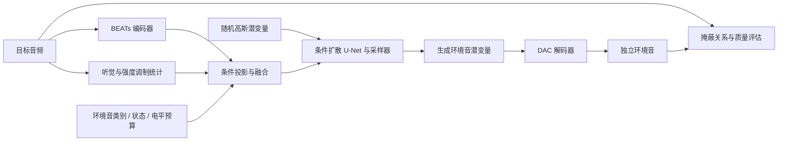

# A2T 技术方案：目标声条件化的环境音生成

> 已确定总体架构，尚未实现或验证模型。本文仅记录技术方案；baseline 的版本、检查点、兼容性与商业许可需在实施时确认。

## 1. 任务边界

输入需要被掩蔽的目标音频（人声、鼾声等），输出具有指定环境音风格、能够降低目标声干扰的独立音频，面向专注或睡眠状态优化体验。

声音持续播放，不由目标声事件触发。第一版从代表性录音提取场景级条件，不要求实时监听或逐事件同步。输出不混入目标声，不进行目标声降噪、分离或主动声学抵消。

首批生成类别为稳定雨声（不含雷声）和连续水流，后续扩展海浪、风声。白、粉红、棕噪音及频谱整形噪声作为传统基线。类别参考 [Softly 助眠页面](https://softly.cc/zh/for-sleep)，其描述不是效果证据，也不代表音频可用于商业训练。

## 2. 总体架构

采用“目标声 embedding + 条件潜空间扩散 + 音频解码”的模块化结构。

**扩散去噪作用于待生成环境音的潜变量，而不是目标声波形或 embedding。** 目标声表征通过条件模块引导去噪，不直接与环境音潜变量相加；两者不要求属于同一表征空间。

训练时另需 DAC 编码器，将授权环境音编码为训练潜变量。目标声编码器与环境音编解码器是不同模块。

## 3. 成熟 Baseline 与选型

| 模块 | 第一版方案 | 初始策略 | 可扩展方向 |
| --- | --- | --- | --- |
| 目标声编码器 | [BEATs 官方预训练模型](https://github.com/microsoft/unilm/tree/master/beats)，优先评估预训练 Iter3 | 冻结，提取特征而非分类概率 | 多层特征、局部微调、替换编码器 |
| 条件适配器 | 小型线性／MLP 投影及类别、状态 embedding | 训练，融合序列与统计条件 | Adapter、条件调制、条件 dropout |
| 生成器 | [stable-audio-tools](https://github.com/Stability-AI/stable-audio-tools) 的条件扩散 U-Net 实现 | 在环境音潜空间训练；具体类与配置需核实 | 交叉注意力、ControlNet 风格分支、DiT |
| 音频编解码器 | [Descript Audio Codec（DAC）](https://github.com/descriptinc/descript-audio-codec)，先评估 24 kHz 检查点 | 冻结，缓存环境音潜变量 | 44.1 kHz、量化策略、替换 codec |
| 训练与采样框架 | stable-audio-tools 扩散组件 | 固定预测目标与采样配置 | 调度器、采样器、流匹配 |
| 掩蔽评估 | 可解释听觉代理及人工验证 | 独立于生成器，不视为真值 | 有可靠标签后训练成对评分器 |

核心模块复用成熟实现，但这不是已有的一体化 pipeline。条件接入、潜变量适配、训练数据与评估属于本项目工作。复用成熟架构不代表拥有适合本任务的预训练生成器权重。

第一版不默认使用 Stable Audio Open 权重；工具代码与模型权重的许可不同。无匹配且许可适用的生成器检查点时，复用 U-Net 架构自行训练。不从零设计通用编码器或 codec，但也不声称已有模块开箱即可完成掩蔽生成。

## 4. 目标声编码与条件注入

BEATs 分支按官方前处理接收 16 kHz 音频，提取特征序列。保留 padding mask 和时频 patch 排列信息，不将所有 token 简单当作等间隔时间帧，也不只保留全局平均向量。

并行提取听觉频带能量、强度分位数及调制／周期统计，保留独立电平信息，避免前处理归一化抹去强度。预训练特征不是天然的“掩蔽表征”，其作用必须通过监督和消融验证。

| 条件 | 建议接入方式 |
| --- | --- |
| 目标声特征序列 | 投影后作为交叉注意力的条件 token |
| 听觉统计与电平预算 | 全局条件调制或附加条件 token |
| 环境音类别 | 可学习 embedding |
| 专注／睡眠状态 | 独立 embedding，不与噪声类别绑定 |

目标录音与生成片段长度可以不同，不建立默认逐帧对齐。类别条件暂不使用大型文本编码器。电平预算除作为输入外，还需外部约束，不能仅依赖网络遵守。

## 5. 潜空间、训练与推理

### 5.1 DAC 潜变量适配

DAC 是带残差向量量化（RVQ）的 codec，不是普通连续 VAE。官方接口的浮点重建向量 `z`、离散 `codes` 和各级 `latents` 含义不同，不能互换。

优先试验在量化后的浮点重建向量 `z` 上进行高斯扩散，由 DAC decoder 解码。该分布仍受码本约束，生成值可能偏离有效分布，必须验证解码质量。不得直接对离散 code 索引加入高斯噪声。

接入前检查 encode/decode 往返、通道数、下采样率、潜变量尺度和归一化逆变换。若这一表征不适合连续扩散，再比较量化前连续表征及重新量化路径，或替换连续自编码器；这些是待验证适配，不是已完成的 baseline 能力。

### 5.2 生成过程

训练时，将环境音 $y$ 编码为 $z_0$，加噪得到 $z_t$，学习条件噪声或速度预测；损失与采样器参数化必须一致。

推理时，从随机 $z_T$ 开始，条件引导迭代去噪，逆归一化后解码：

$$
c = P(E_n(n), a(n), c_{\mathrm{style}}, c_{\mathrm{state}}, c_{\mathrm{level}}),
\qquad \hat z_0 = \operatorname{Sample}(G_\theta, z_T, c),
\qquad \hat y = D_{\mathrm{DAC}}(\hat z_0).
$$

其中 $n$ 是目标声，$a(n)$ 是显式听觉统计。输出为独立环境音，评估混音单独构建。检查最终峰值、响度与连续性；改变输出增益后必须重新评估掩蔽效果。

### 5.3 分阶段训练

1. 验证 BEATs 特征与 DAC 环境音重建，建立冻结 codec 的潜变量缓存。
2. 训练类别条件扩散，先验证环境音自然度和可生成性。
3. 接入目标声条件，通过受电平约束的候选筛选、排序或有效优化信号建立掩蔽关系。
4. 有验证证据后，再微调编码器或增加控制分支。

**随机配对目标声和环境音进行扩散训练，不足以学习掩蔽关系。** 没有可靠监督时，先使用基础生成器加候选筛选，不宣称生成器已学会目标声条件。

目标包含基础扩散损失、掩蔽代理、风格／自然度和连续性约束。黑盒指标用于排序；可微波形损失需从所选参数化构造去噪估计，再经过 decoder 计算，并验证梯度和成本。

掩蔽是目标声、生成声和播放级别之间的关系。频带覆盖或 ASR 错误率不能直接等同于人的干扰程度。代理需听评验证；专注需任务实验，真实助眠效果需独立睡眠研究。

## 6. 可扩展研究设计

模块通过独立的 `TargetEncoder`、`ConditionAdapter`、`AudioCodec`、`Denoiser`、`Sampler` 和 `Evaluator` 接口连接。配置记录检查点、采样率、张量形状、mask、潜变量缩放和预测类型，避免业务逻辑绑定单个库。

### 6.1 ControlNet 风格分支

在 U-Net 多尺度位置预留残差注入接口。后续控制分支接收频带覆盖目标、平稳包络等要求，使用零初始化残差投影；先冻结已验证的基础生成器，仅训练控制分支。

目标声 embedding 仍由交叉注意力接入，额外分支不替代基础条件。控制信号需映射到输出侧并明确长度和尺度适配，不默认目标声与输出逐帧同步，不复制人声或鼾声波形。

这是借鉴 ControlNet 的一维音频研究扩展，不是可直接使用图像 ControlNet 权重的模块。关闭扩展后，基础模型必须仍可独立运行。

### 6.2 功能保持的环境声风格转换

作为额外假设，比较“可控基础掩蔽声 → 环境音风格转换”，约束转换后的掩蔽效果。保留的是功能需求，不是目标声内容；转换后重新评估。该路线不替代直接条件生成，不纳入第一版核心实现。

## 7. 验证、资源与商业化

- 比较听觉统计、BEATs、BEATs + 统计；按需要增加 PANNs 等编码器对照。
- 比较正确、错配、无目标声条件，以及各研究分支开关。
- 保留彩色噪声、频谱整形、固定授权自然声和仅类别条件生成基线。
- 按个体和原始录音来源划分数据，测试集不用于参数选择。
- 在一致噪声与可比播放级别下报告掩蔽、自然度、自身干扰、连续性和运行成本。
- 分段生成、交叉淡化用于长时播放，检查接缝、低谷和重复感，不称为原生数小时生成。

硬件为 RTX PRO 6000 Blackwell，实际显存、驱动、CUDA、PyTorch 兼容性尚未实测。原型从 DAC 24 kHz、单声道、5–10 秒片段开始，再依据高频自然度与成本评估 44.1 kHz。BEATs 分支独立重采样为 16 kHz，不限制输出采样率。批量、模型规模和训练预算通过运行检查确定。

项目计划商业化：BEATs 官方说明引用 UniLM 根目录许可证，具体检查点授权仍需确认；DAC 官方 README 明确其发布权重采用 MIT 许可，实施时保留版本与声明。stable-audio-tools 工具代码、第三方组件及任何预训练权重分别审查，不将工具许可等同于权重许可。训练数据必须可追溯并具备适用权限。

未校准耳旁声压时只报告数字域相对电平结果，不声称现实播放安全性或普遍有效掩蔽。

已确定总体结构与 baseline 首选；待验证具体许可、DAC 潜空间适配、U-Net 配置、掩蔽监督与数据规模。本文不表示模块已集成或效果已成立。

## 8. 数据集构建

采用三个关联数据层：环境声库、目标声库和掩蔽关系集。原始文件独立保留；片段和关系通过 ID 引用来源，不需要保存全部组合波形。以下长度与电平为原型起点，不是已验证的最优规格。

### 8.1 环境声数据集

用于学习环境音的风格、局部纹理和自然动态。首批类别为稳定雨声与连续水流；水流进一步标记溪流、河流、瀑布等子类。首版排除明显人声、音乐、雷声、设备干扰和异常削波，保留排除原因。传统合成噪声另行标记，不默认作为自然声生成训练素材。

| 数据层级 | 初始规格 | 用途 |
| --- | --- | --- |
| 原始素材 | 优先保留 1–10 分钟以上连续录音，短素材单独记录 | 保留上下文与来源 |
| 扩散训练片段 | 默认 8 秒，实际样本数按 codec 与 U-Net 要求对齐 | 学习局部声景纹理 |
| 自然度检查 | 固定 30–60 秒片段 | 检查变化与自然结构 |
| 长时测试 | 原生连续 2–5 分钟或更长 | 分析低谷、漂移与重复感 |

训练集可随机裁剪；验证和测试采用固定、尽量不重叠的窗口。原生长录音和模型拼接输出分别记录。海浪等明显涨落类别后续需要覆盖完整周期，不能直接沿用 8 秒规格。

元数据至少包含 `source_id`、`session_id`、类别／子类、授权来源、原始采样率与声道、时长、片段起止、处理版本及质量标签。增加独立录音来源比反复切同一录音更重要，切片数量不等于独立样本数量。

### 8.2 目标声数据集

鼾声保留连续事件、呼吸与安静间隔，不只收集孤立事件。默认使用 30 秒场景条件窗口，并比较 15／30／60 秒；原始录音优先保留 1–5 分钟或更长上下文。窗口事件不足时延长上下文或标记为稀疏，不假定每个窗口都有足够周期。

记录鼾声事件起止、数量、活动比例、强度分位数、频带能量和周期稳定性。保留适量稀疏／无鼾声窗口，标记条件有效性；不能通过删除间隔人为提高密度。人声扩展记录说话人、语音活动与间歇，沿用来源隔离原则。

目标元数据包含匿名 `subject_id`、录音／夜晚 ID、设备与环境（已知时）、授权与隐私记录、事件标注及片段来源。未知个体标记为未知，不通过文件名猜测身份，也不据此声称跨个体泛化。

不逐鼾声事件峰值归一化。窗口内强弱关系须保留；未经校准的录音振幅不能用于推断不同人的真实耳旁声压。

### 8.3 掩蔽关系集

关系集表达“某目标声在某播放条件下，哪些环境声更有效且更舒适”，不是唯一正确音频配对。关系单位为：

$$
(\text{目标窗口},\ \text{候选环境声},\ \text{电平与播放条件},\ \text{评价记录})
$$

构建流程：

1. 对每个目标窗口选择不同类别、频谱和动态的候选，包括传统基线、授权自然声与生成候选；保留可能失败的候选。
2. 在预实验确定的多个相对电平下构造评估混音，初始可试验 -6／0／+6 dB；这些数值不是推荐播放声压或安全阈值。
3. 固定测试时长和电平基准，记录目标声、环境声及混合增益，检查削波。
4. 分别记录自动代理与人工评价；缺失标签保留为空，不用自动分数冒充人工标签。
5. 在同一目标和可比播放条件下，构造有足够评价支持的候选排序／偏好，不强行将多维评价合并为唯一总分。

相对电平定义为 $\Delta L=L_{\mathrm{masker}}-L_{\mathrm{target}}$，两者必须采用同一约定的测量方法。鼾声整窗 RMS 会受安静比例影响，因此同时记录整窗与事件活动段电平；使用哪一个设定增益需在评估协议中固定，不能混用。

评估混音为 $x(t)=g_n n(t)+g_y y(t)$。若需防削波，采用共同衰减并记录，不分别重新归一化或隐式限幅；共同衰减保留相对比例，但改变绝对播放电平，真实听评需重新确认校准。混音仅用于评估，生成器输出仍是独立环境声。

30 秒目标条件与 8 秒生成训练片段功能不同。关系评估优先使用同长原生环境声，或明确标记生成延续／拼接方式；不将重复 8 秒音频伪装成原生 30 秒素材。短段标签不自动外推为长时效果。

每条关系记录包含 `relation_id`、目标／候选 ID、电平测量基准、各路与共同增益、时长、对齐偏移、播放设置、评价版本及来源。生成候选还需记录模型版本、种子与条件。人工评价记录匿名评者、顺序与重复试次，用于分析一致性；评分方向统一。

## 9. 划分与后处理逻辑

### 9.1 三层数据集统一划分

**先隔离来源，再切片、增强和构建关系。** 初始按约 80%／10%／10% 分训练、验证、测试；比例服从独立个体与来源数量，不按片段数量机械分配。

| 数据集 | 隔离单位 | 规则 |
| --- | --- | --- |
| 目标声 | 鼾声个体／说话人 | 同一人的不同夜晚与录音归同一集合 |
| 环境声 | 原始录音、会话及近重复来源组 | 同源裁剪、转码和重复上传不跨集合 |
| 掩蔽关系 | 两端的来源划分 | 训练仅组合训练两端，验证和测试对应使用各自集合 |

来源不明的目标声按可确认录音组隔离，并披露个体泄漏风险。若元数据缺失会影响关键结论，应排除相关样本或单列分析。必要时另设跨设备／房间外部测试集。

增强音频、BEATs 特征和 DAC 潜变量继承原始 split，不重新随机划分。用于学习评分器的人工标签也按来源隔离；评者隔离可作为额外泛化实验。独立测试不参与评分器训练、候选规则或生成器调优。

测试生成候选可以使用已训练生成器，但必须基于未见目标条件、固定配置和预先约定的候选预算；若使用已训练评分器筛选，报告完整筛选流程，不用测试人工反馈回选候选。

### 9.2 后处理与缓存

- 原始层：只读保留原文件、来源与许可；先检查损坏、削波、重复及隐私风险。
- 处理层：分别生成 BEATs 所需 16 kHz 单声道与 codec／评估所需 24 kHz 版本，记录重采样、声道转换、裁剪和增益。上采样不恢复原始缺失带宽。
- 片段层：保留鼾声内部动态和间隔，不默认做降噪、静音删除或时间拉伸；任何增强只用于训练并记录参数。环境声电平处理采用固定策略，保存增益，不能用于推断原始声压。
- 短素材：不能通过循环或补静音制造独立样本。训练长度不足时排除或采用明确的变长／mask 策略；固定长生成 baseline 初期优先使用足长素材。
- 特征层：BEATs 缓存保存检查点、前处理、mask 和片段定位；DAC 缓存保存版本、潜变量类型、形状和缩放信息。归一化统计仅在训练集拟合。
- 关系层：混音可按配置动态重建；保存指标和听评版本，必要时缓存试听文件。不对混合后的目标声再次降噪。
- 生成输出：记录拼接、交叉淡化与最终增益；后处理改变频谱、动态或电平后重新计算评价，不复用处理前标签。

初期试点可使用 10–20 个已知鼾声个体、多个独立雨声／水流来源和三档相对电平，验证流程与差异是否稳定。它不是足够训练生成器或证明泛化的保证；正式规模依据学习曲线、来源多样性和评估不确定性确定。

## 10. 数据集与模型训练的关系

| 阶段 | 使用数据 | 学习内容／限制 |
| --- | --- | --- |
| 编码与重建检查 | 目标声库、环境声库分别使用 | 验证 BEATs 表征与 DAC 重建，不直接学习掩蔽 |
| 基础声景扩散 | 环境声训练集及类别标签 | 学习环境声分布与自然纹理 |
| 关系评估与候选排序 | 掩蔽关系训练集 | 校准代理或训练成对评分器，分开处理干扰与舒适度 |
| 目标声条件生成 | 有效关系监督及环境声数据 | 学习条件投影与生成响应；需要明确的条件学习信号 |
| 最终验证 | 来源隔离的关系测试集及长时输出 | 验证未见目标声、条件贡献和后处理效果 |

可将可靠筛选的多个环境声作为同一目标条件下的训练候选，但须记录筛选偏差和标签置信度，不将其当作唯一正确答案。短训练片段是否继承长关系标签需验证，必要时重新进行短段评价。

排序损失首先训练关系评分器；它不会自动训练扩散生成器。将评分反馈用于生成器需要可微去噪估计、经过验证的奖励／偏好优化或其他明确路径。若只做生成后排序，应报告为“生成 + 筛选”，不能声称扩散模型本身学会了掩蔽。

生成器优化保留环境声基础训练以限制分布漂移；目标条件通过正确／错配／无条件消融检验。ControlNet 与功能保持风格转换暂为独立扩展，不改变上述基础数据划分。

## 11. 掩蔽效果评估 Baseline

当前确定采用“心理声学听觉前端 + 两条互补测量路径”的双分数 baseline。它借鉴 PEAQ 后附资料4及附件2中的掩蔽阈值、内部表示、激励扩展和时间处理思想，但不直接复用 PEAQ 的 ODG、DI 或神经网络权重。PEAQ 原本评价编解码失真质量，本项目评价目标声在环境声中的剩余可察觉性。

### 11.1 评估输入与听觉前端

定义三路输入：

$$
n(t)=\text{目标声},\qquad m(t)=\text{环境掩蔽声},\qquad x(t)=m(t)+n(t)
$$

其中 $x(t)$ 只用于评估，产品输出仍是独立的 $m(t)$。三路采用相同的播放级别映射、时间基准和声道处理；不得分别归一化 $m(t)$ 与 $x(t)$。

第一版采用参考 PEAQ 的 **FFT + Bark 听觉前端**，不实现 PEAQ 高级滤波器组版本：

- 评估采样率 48 kHz；生成器可以使用 24 kHz，评估时独立重采样。
- 2048 样本 Hann 窗，50% 重叠，帧移 1024 样本，约 42.67 ms 窗长。
- 外耳与中耳频率加权。
- Bark 频带分组。
- 频率相关内部噪声。
- 声级相关频域扩展。
- 前向时间掩蔽的时间扩展。

暂不加入 PEAQ 的电平／频谱适应补偿、原 ODG 映射网络、滤波器组高级分支或认知映射。所有公式和常数实施前须与原始 PDF 核对；当前 Markdown 中已发现至少一处公式转换错误，不能直接照抄实现。

若未完成真实声压校准，回放级别只表示数字域到假定声压级的映射，不能将 PEAQ 的 92 dB SPL 默认值解释为实际播放音量或安全阈值。24 kHz 数据不包含 12 kHz 以上有效信息，需记录这一带宽限制。

### 11.2 分数一：阈值暴露分数

该路径借鉴 PEAQ／NMR 的“掩蔽阈值比较”，但分子改为目标声，而不是编解码误差信号。由环境声 $m$ 的听觉表示估计掩蔽模式 $M_m(b,t)$，由目标声 $n$ 的耳响应加权频带能量得到 $P_n(b,t)$：

$$
r_{\mathrm{thr}}(b,t)=10\log_{10}\frac{P_n(b,t)+\epsilon}{M_m(b,t)+\epsilon}
$$

逐帧汇总为：

$$
S_{\mathrm{thr}}(t)=10\log_{10}\left[\frac{1}{B}\sum_b\frac{P_n(b,t)+\epsilon}{M_m(b,t)+\epsilon}\right]
$$

该分数越低，表示预测的目标声超阈值暴露越少。它是**项目任务化的 NMR 风格分数**，不是标准 NMR，也不是直接的人类可听概率。$P_n$ 与 $M_m$ 必须经过单位和处理阶段校准，不能把已经频域扩展的激励再次与不兼容的阈值直接相除。

### 11.3 分数二：内部表示距离

该路径借鉴 PERCEVAL／ASD 的“听觉内部表示比较”。分别计算环境声 $m$ 和混合声 $x=m+n$ 的最终激励模式 $E_m(b,t)$ 与 $E_x(b,t)$，定义：

$$
S_{\mathrm{rep}}(t)=\frac{1}{B}\sum_b\left|10\log_{10}E_x(b,t)-10\log_{10}E_m(b,t)\right|
$$

该分数越低，表示加入目标声后听觉内部表示的变化越小，预测的目标声显著度越低。它是内部表示变化量，不是未经实验校准的检测概率；不得直接套用 PEAQ 的检测概率或 ODG 映射。

两项分数暂不归一化、不加权、不合成为单一百分制。保留频带和帧级结果，同时报告事件统计，使失败原因可解释。

### 11.4 鼾声事件汇总

听觉前端在连续目标声、环境声和混合声上下文上运行，不因每个鼾声事件而重置时间状态。事件边界来自目标声原始标注，不由混合声检测结果决定，避免掩蔽成功后事件被漏检。

每个事件按与分析帧的重叠比例聚合，边界帧采用重叠比例加权。最终分别报告：

- 事件等权平均分：防止长事件支配结果。
- 活动时长加权平均分：反映整体鼾声暴露时间。
- 较差事件分数：使用预先固定的高分位数，反映最难掩蔽事件。
- 活动时间暴露比例：例如至少一个频带超过预设阈值的帧比例，仅作为解释性代理。

无目标事件的窗口记为不适用，不记为完美掩蔽。安静间隔不用于稀释事件级结果，但可作为完整场景的辅助统计。

### 11.5 验证要求与后续学习型评估器

Baseline 先直接输出 $S_{\mathrm{thr}}$ 和 $S_{\mathrm{rep}}$ 及其事件统计，不使用学习权重。必须用合成信号和受控听评检查：目标声为零时内部表示距离是否接近零；重复输入是否一致；掩蔽声低谷与目标事件重叠时局部暴露是否上升；改变相对电平时分数是否按预期变化。

随后使用随机化／盲听实验验证两项分数对目标声可察觉性的排序和预测误差。舒适度、掩蔽声自身干扰、专注任务表现和睡眠适配另行记录，不混入这两个 baseline 分数。鼾声检测器置信度和 ASR 错误率只能作为辅助指标。

在有足够人工标签后，才增加学习型融合器：

$$
\hat y=b+w_1\tilde S_{\mathrm{thr}}+w_2\tilde S_{\mathrm{rep}}
$$

其归一化参数和权重只在训练集拟合，验证／测试固定使用。学习型融合器必须与两个单指标比较，并按鼾声个体和环境声来源隔离测试。自适应门控权重属于更后续的研究扩展，不是 baseline 的组成部分。

短时听评只能验证可察觉性和主观干扰，不能据此宣称真实助眠效果。未经声压校准，也不能宣称现实环境中的绝对掩蔽能力或听力安全性。

[四周执行计划](docs/PLAN_4_WEEKS.md) 保留在原位置，尚未按本次技术方案重新对齐；README 不包含执行排期。