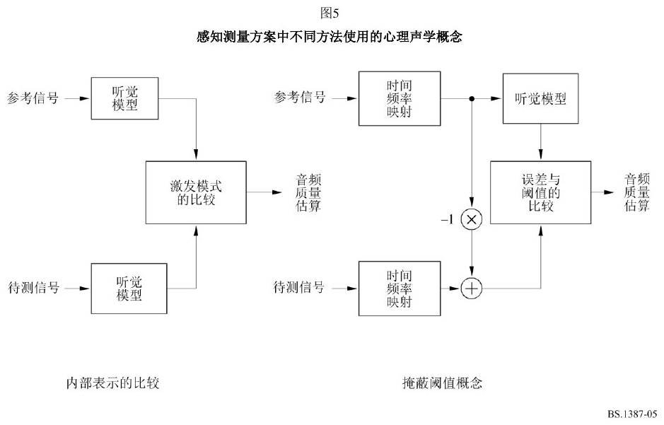
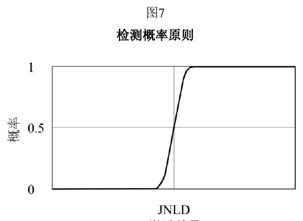
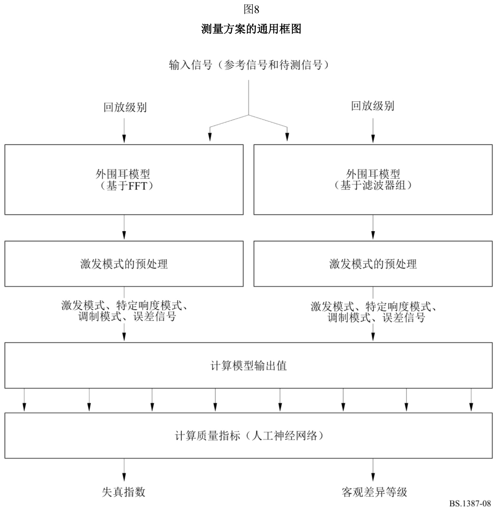
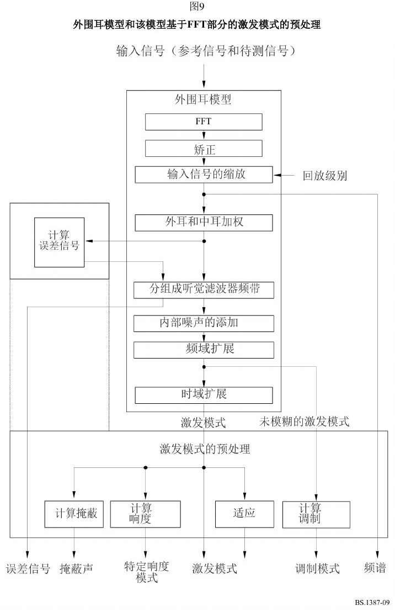
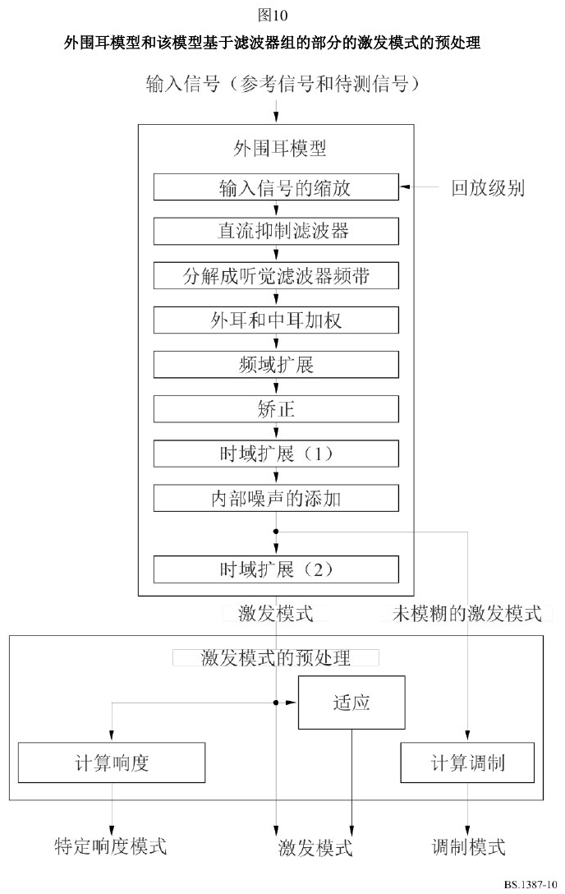
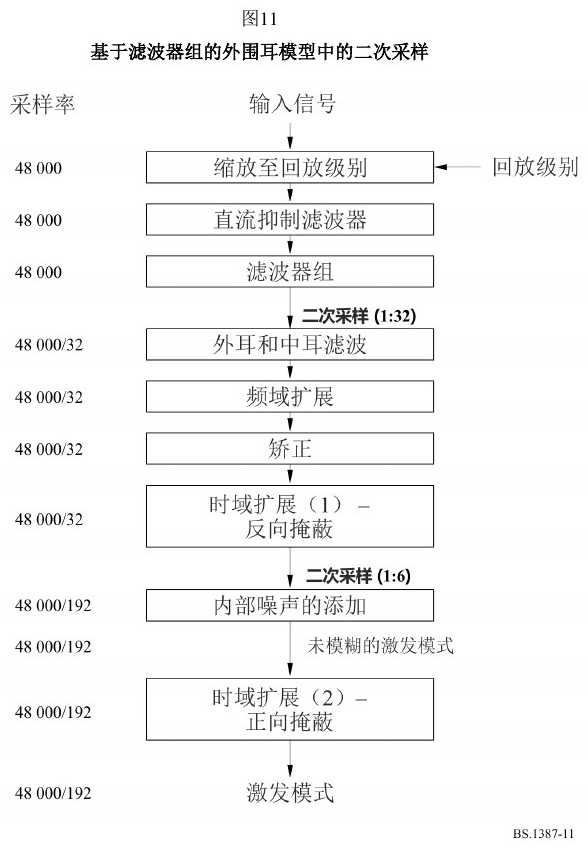

# 感知音频质量的客观测量方法（PEAQ）

> **来源文档**：ITU-R BS.1387-2建议书《感知音频质量的客观测量方法》（05/2023）中文版
> **转换范围**：自「附件1的后附资料4」起，至「附件2 模型描述」末（原文档第 20–69 页），含全部公式（式(1)–(96)）、插图（图5–图11）与表格（表5–表23）。
> **说明**：公式以 LaTeX 排版并保留原文编号；插图裁剪自原 PDF，存放于 `assets/` 目录。

---

# 附件1的后附资料4

## 客观感知音频质量测量方法的原则和特性

## 1 引言和历史

音频信号的数字传输和存储正日益基于数据简化算法，该算法适应人类听觉系统的特性，尤其依赖于掩蔽效应。此类算法的主要目的不是使失真最小化，而是试图以尽可能少被察觉的方式处理这些失真。这些感知编码器的质量不能再通过传统的测量方法来加以评估，传统的测量方法通常确定失真的总体值。说明这些限制的常见例子之一是所谓的 13 dB 奇迹：频谱结构与音频信号相适应的叠加噪声几乎听不见，即使最终的未加权信噪比下降到 13 dB 亦是如此。

因此，为了对感知编解码器进行评估，需要进行听力测试，以评估音频质量。听力测试的充分可靠性和可重复性亦需要大量的时间和工作。

结合人类听觉系统特性的客观测量方案有助于克服这些问题。这一观点最早由 [Schroeder等人，1979年] 发表。在这篇主要关于语音编码的文章中，描述了测量方案「噪声响度（NL）」。

在上述文章中，对大约 20 毫秒的每个时间帧估算语音编解码器的噪声信号的感知响度，即其输入和输出信号之间的差异。如果噪声信号被完全掩蔽，则感知响度为零。部分掩蔽降低了未掩蔽噪声信号的响度。所使用的掩蔽阈值针对音调掩蔽噪声进行了优化，并针对每一帧计算最终的语音劣化。不计算语音样本总质量的汇总。

1985 年，Karjalainen 发表了测量方案「听觉频谱差异（ASD）」[Karjalainen，1985年]。他从 Schroeder、Atal 和 Hall 的几个想法开始，但用带重叠滤波器的滤波器组取代了基于帧的分析，改变了包含绝对阈值的方式，并添加了时间掩蔽模型。测量方案的两个输入信号以完全相同的方式进行处理，并产生了一种内部表示。对这些内部表示加以相互比较，以解释语音编码方案的输入和输出信号之间的感知差异。不计算语音样本总质量的汇总。ASD 的时间分辨率更好地适应人类听觉系统的特性，但是增加了算法的复杂性。

1987 年，Brandenburg 发表了测量方案「噪声掩蔽比（NMR）」[Brandenburg，1987年]，该方案旨在被用作开发音频编码方案的工具。通过使用被设计为最坏情况曲线的扩展函数来计算感知频带上的扩展，与噪声响度相比，该方案的复杂度降低了。所使用的掩蔽阈值针对噪声掩蔽音进行了优化。添加了一个简单的后期掩蔽建模方案和多种评估较长音频片段感知质量的方法。这是第一个在实时硬件中实施的方案。

1989 年，Moore 和 Glasberg [Moore，1989年] 提出了一个感知模型，但没有提出判断受损音频信号的感知质量的方法。

## 2 客观感知音频质量测量方法的一般结构

所有感知测量方案均使用两个输入信号：一个被称为参考信号（REF），另一个被称为待测信号（SUT）。在参考信号无法传输到测量设备但信号已知的情况下，参考信号可以是存储在测量设备自身中的内部参考信号。输入信号必须是时间对齐的。

可以通过两种不同的方式将心理声学融入测量方案。第一种可能性与音频编码方案的结构非常相似：参考信号用于估算实际掩蔽阈值（见下文）。将待测信号和参考信号之间的差异与该掩蔽阈值进行比较。这种方法被称为「掩蔽阈值概念」，用于噪声响度和 NMR。输入信号之间的差异可以在时域中计算，或者作为短时能谱之间的差异来计算。后者针对时间对齐误差提供了更好的稳健性，但是降低了时间分辨率。时域中的差异通常对相位失真过于敏感，因此不再使用。

第二种方法更接近人类听觉系统的生理过程：计算参考信号和待测信号的所谓内部表示。这种内部表示是对人脑可用于信号比较的信息的估算。这种方法被称为「内部表示的比较」，在 ASD 中使用。

## 3 心理声学和认知基础

本节讨论人类听觉系统的特性，这些特性在音频信号感知质量的评估中最为突出。重点在于如何对这些特性建模。



### 3.1 外耳和中耳传递特性

一般来说，声音信号必须通过外耳和中耳，随后它们到达内耳，并在内耳中执行声音检测和分析过程。外耳和中耳对输入信号执行带通滤波操作。听觉神经中存在的噪声以及由血流引起的噪声被添加到输入信号中。这种噪声的幅度随着频率的降低而增大。外耳和中耳传递函数以及内部噪声限制了检测小音频信号的能力，并且对听觉的绝对阈值影响最大。

### 3.2 感知频率标度

人耳中的声压感受器是毛细胞，它们位于内耳，更准确地说是位于耳蜗。在耳蜗中，执行频率到位置的转换。最大激发的位置取决于输入信号的频率。耳蜗上给定位置的每个毛细胞负责频率标度上的重叠范围。音高的感知印象与毛细胞的恒定距离相关。

根据所使用的心理声学实验，已经发现了从频率到音高的不同变换函数：

在 [Zwicker和Feldtkeller，1967年] 中，给出了一个表格，该表格将频率范围（单位为赫兹）划分为 24 个非重叠频带，即所谓的临界频带。表5给出了这些频带的截止频率上限。该表还包含巴克标度的定义：1 巴克对应于 100 赫兹，24 巴克对应于 15 500 赫兹。

**表5 Zwicker定义的临界频带范围**


| 临界频带             | 1   | 2   | 3   | 4   | 5   | 6   | 7   | 8   | 9     | 10    | 11    | 12    |
| -------------------- | --- | --- | --- | --- | --- | --- | --- | --- | ----- | ----- | ----- | ----- |
| 上限截止频率（赫兹） | 100 | 200 | 300 | 400 | 510 | 630 | 770 | 920 | 1 080 | 1 270 | 1 480 | 1 720 |


| 临界频带             | 13    | 14    | 15    | 16    | 17    | 18    | 19    | 20    | 21    | 22    | 23     | 24     |
| -------------------- | ----- | ----- | ----- | ----- | ----- | ----- | ----- | ----- | ----- | ----- | ------ | ------ |
| 上限截止频率（赫兹） | 2 000 | 2 320 | 2 700 | 3 150 | 3 700 | 4 400 | 5 300 | 6 400 | 7 700 | 9 500 | 12 000 | 15 500 |

过去发现了几种近似的巴克标度。有关不同标度的详细讨论可参见 [Cohen和Fielder，1992年]。在感知音频质量客观测量的背景下，使用巴克标度可以获得最佳结果。

### 3.3 激发

每个毛细胞对一系列频率做出反应，这些频率可以通过滤波器特性来描述。如上所述，滤波器的斜率可以在感知量表上得到最佳表达。这种量表的滤波器形状几乎与中心频率无关。激发的较低斜率与输入信号的电平 $L$ 无关（约 27 分贝/巴克）。输入信号较低电平时的上斜率比较高电平时更陡（−5 至 −30 分贝/巴克）。这种陡峭的特性是由两种不同毛细胞之间的反馈机制引起的，需要一些时间来加以稳定。因此，对于信号开始后几毫秒的稳定信号，可以获得最佳的听觉频率分辨率。由几个分量组成的信号的激发模式以非线性方式相加。

![图6 基于Terhardt[1979年]的激发水平依赖性](assets/fig6.png)

暴露于信号后，毛细胞和神经处理需要一些时间来恢复，直到再次达到完全敏感。恢复过程的持续时间取决于信号的电平和持续时间，且可持续数百毫秒。在毛细胞和大脑之间的通路上，高电平信号比低电平信号处理得更快。因此，强信号的出现会掩蔽之前较弱的信号。

另一种模型激发方法基于 ERB 标度 [Moore，1986年]。这种方法使用所谓的 ROEX 滤波器 [Moore，1986年]。在感知音频质量客观测量的背景下，基于 [Zwicker和Feldtkeller，1967年] 和 [Terhardt，1979年] 的模型可以获得更好的结果。

### 3.4 检测

不同音频信号的激发被传递到人脑。在此方面，存在三种不同的记忆：长期记忆、短期记忆和超短期记忆，其详细程度和信息存在的持续时间亦有所不同。在听力测试中，超短期记忆的作用最为突出。如果音频节录的持续时间少于五到八秒（取决于听者和音频节录），则信号的大部分细节均会保留。在 ITU-R BS.1116建议书中定义的评估程序中考虑到了这一点，其中允许受试者选择音频节录的非常短的部分来更仔细地聆听。在检测阈值处，检测概率为 50%。在阈值附近，检测到差异的概率从 0% 平滑增加到 100%。

最小可觉电平差（JNLD）是电平差的检测阈值。JNLD 受输入信号电平的影响。对于小信号，检测需要较大的差异（电平：20 dBSPL，JNLD：0.75 dB）。对于强信号，对微小差异的灵敏度要高得多（电平：80 dBSPL，JNLD：0.2 dB）。这些数字是基于调幅实验得出的。



### 3.5 掩蔽

一个单独出现时清晰可闻的信号在另一个信号（掩蔽信号）出现时可能完全听不见。这种效应称为掩蔽效应，被掩蔽的信号称为被掩蔽声（maskee）。必须区分两种情况：

- **同时掩蔽**

  在此情况下，掩蔽声（masker）和被掩蔽声同时出现，并且是准静态的。如果掩蔽声具有离散带宽，则即使对于低于或高于掩蔽声的频率，听觉阈值亦会提高。掩蔽的量取决于掩蔽声和被掩蔽声的结构。在类噪声信号掩蔽音调信号的情况下，掩蔽量几乎与频率无关。如果被掩蔽声的声压级比掩蔽声的声压级低 5 分贝左右，则被掩蔽声就听不见了。在音调信号掩蔽类噪声信号的情况下，掩蔽量取决于掩蔽声的频率。通过公式

  $$
  (15.5 + z/\mathrm{Bark})\ \mathrm{dB}
  $$

  可以对掩蔽量进行估算，其中 $z$ 是掩蔽声的临界频带速率。此外，在高信号电平情况下，非线性效应降低了掩蔽声附近的掩蔽阈值。音调掩蔽音亦有类似的效果。几个信号的掩蔽阈值以非线性方式相加。一般来说，得到的掩蔽阈值高于每个单独信号产生的掩蔽阈值。
- **时间掩蔽**

  在此情况下，掩蔽声和被掩蔽声出现在不同的时间。在掩蔽声衰减后不久，掩蔽阈值更接近于该掩蔽声的同时掩蔽，而非绝对阈值。根据掩蔽的持续时间，阈值的衰减时间可以在 5 毫秒（掩蔽声：持续时间约为 0.05 毫秒的高斯脉冲）和 150 毫秒以上（掩蔽声：持续时间为 1 秒的粉红噪声）之间。恰处于较大信号之前的微弱信号被掩蔽。这种反向掩蔽效应的持续时间约为 5 毫秒。如果被掩蔽声恰好高于阈值，则其在掩蔽声之前不会被感知到，而是被感知为掩蔽声的变化。反向掩蔽显示了不同听者之间的较大偏差。

### 3.6 响度和部分掩蔽

音频信号的感知响度取决于其频率、持续时间和声压级。由于自动掩蔽，复合信号的响度小于其所有分量的响度之和。在音频质量测量的背景下，添加到参考信号的无用失真的响度（噪声响度）通过参考信号引起的部分掩蔽而降低。

### 3.7 锐度

锐度是感觉的基本值之一，与音色有关。如果声音主要包含高频成分，则会被认为是尖锐的。例如，高频的正弦音或带限噪声，或者截止频率在约 3 kHz 以上的频率范围内的高通噪声被称为锐噪声。不过，音频信号的详细频率结构对锐度没有重大影响。Von Bismarck [1974年] 进行了有关锐度的基础研究。

[Aures，1984年] 进行了有关锐度的其他研究。这些研究的结果是一个与 Bismarck 定义的加权函数相比略有修改的加权函数。在非常低和非常高的临界频带速率下，其对锐度属性的贡献较小，而在 14 和 20 巴克之间的临界频带速率下贡献较大。此外，这些研究表明，具有音频信号声压水平的高变化和强高频内容的音频信号的锐度不能仅基于整体响度，而是基于取决于整体响度的加权函数。

### 3.8 认知处理

很明显，感知音频质量受到认知效应的强烈影响。这可以通过一个简单的实验来证明。

具有清晰可闻的背景噪声的参考信号由一些不能传输该背景噪声的音频设备进行处理。由于噪声是一种无用失真，在收听测试中，参考信号将被评定为比处理后的信号更差。另一方面，如果参考信号中最重要的部分是软背景噪声，则同一经处理信号的得分会更低。

列出所有可能的认知效应超出了本后附资料的范围，但在此列出一些示例：

**示例1：线性失真和非线性失真的分离**

线性失真比非线性失真更不令人反感。通过使用输出信号的自适应逆滤波，可以相当容易地实现线性失真和非线性失真的分离。本建议书中规定的方法使用线性和非线性失真的分离。

**示例2：听觉场景分析**

听觉场景分析 [Bregman，1990年] 是一种认知过程，它允许听者将不同的听觉事件分开并将其分组到不同的对象中。[Beerends和Stemerdink，1994年] 中给出的实用方法对于量化听觉场景分析效果非常有用。如果时间-频率分量没有被编解码器编码，则剩余的信号仍然形成一个连贯的听觉场景，而新的不相关时间-频率分量的引入则导致两种不同的感知。由于分成两种不同的感觉，失真将比根据新引入的失真分量的响度所预期的情况更令人反感。这导致由未编码时间-频率分量引起的失真的感知干扰与由引入新的时间-频率分量引起的干扰之间出现不对称的问题。

**示例3：信息掩蔽**

信息掩蔽可以通过定义类似熵的频谱-时间复杂度指标来建模。此类效应很可能取决于受试者在进行主观评估之前接受的训练量。在 [Beerends等人，1996年] 中介绍了对此效应建模的第一次尝试，其中计算了大约 100 毫秒的时间窗口内的本地复杂度估算。如果这个本地复杂度很高，那么在这个时间窗口内的失真比本地复杂度低时更难听到。训练可以将掩蔽阈值降低几个 10 分贝 [Leek和Watson，1984年]。

**示例4：频谱-时间加权**

音频信号中的一些频谱-时间区域携带更多信息，因此可能比其他区域更重要。频谱-时间加权在语音编解码器的质量判断中十分重要。在语音中，一些频谱-时间成分（如共振峰）显然比其他成分携带更多的信息 [Beerends和Stemerdink，1994年]。不过，在音乐中，信号中所有的频谱-时间成分均可能携带信息，甚至在静音中亦会如此。

## 4 模型合并

### 4.1 干扰指数（DIX）

感知测量方法 DIX（干扰指数）[Thiede和Kabot，1996年] 基于听觉滤波器组，该滤波器组产生高时间分辨率，从而允许（与基于 FFT 的方法相比）对时间效应（如预掩蔽和后掩蔽）进行更精确的建模。每个听觉滤波器处的包络的时间精细结构被保留，并用于获得有关信号和所引入失真的附加信息。

各个滤波器的中心频率在感知音高范围内均匀分布。滤波器形状的顶部略呈圆形，以确保所选数量的滤波器覆盖整个频率范围，而不会在整体频率响应中产生纹波。为了对掩蔽阈值建模，滤波器斜率在巴克标度上呈指数下降。滤波器斜率的陡度取决于输入信号的电平。在 DIX 的第一个版本中，可听频率范围由 80 个滤波器覆盖，后来减少到 40 个滤波器，即频率分辨率对应于大约 0.6 巴克。与具有单个滤波器的其他滤波器组相比，滤波器组算法相当快，但仍比基于块的变换（如 FFT 和小波包变换）耗时得多。

DIX 动态调整待测信号和参考信号之间的电平和频谱，以区分线性失真和非线性失真。它评估滤波器输出端的时间包络结构，以模拟与纯音相比由调制和类噪声掩蔽器引起的掩蔽量增加。

通过比较待测信号和参考信号的内部表示，计算出许多输出参数，其中包括非线性失真的部分响度、线性失真量指标以及时间和双耳效应指标。不过，基本音频质量的良好估算可以通过仅使用两个输出参数来实现：非线性失真的部分响度以及线性失真量的指标之一被映射到待测信号的预期基本音频质量的估算。

### 4.2 噪声掩蔽比（NMR）

测量方案 NMR（噪声掩蔽比）[Brandenburg，1987年] 评估掩蔽阈值和噪声信号之间的电平差。具有约 20 毫秒汉宁窗的 DFT 用于分析信号的频率成分。根据巴克标度将变换系数组合成频带。为每个频带估算掩蔽阈值。掩蔽阈值的斜率是使用最坏情况方法导出的，该方法考虑了以下事实：对于弱信号，斜率更陡，但在较高电平时会达到绝对阈值。绝对阈值适应输入信号的分辨率（通常为 16 位），但不适应心理声学需求。由于上述事实，NMR 对于再现电平的变化是稳健的。音高标度分辨率约为 1 巴克。由于所需的计算能力较低，因此有可能在其开发的早期阶段将 NMR 实施为实时系统。

该模型自 1987 年以来一直在使用，且已证明其基本可靠性。

NMR 最重要的输出值是掩蔽标志率（给出听觉失真帧的百分比）以及总 NMR 和平均 NMR，它们是平均误差能量和掩蔽阈值之间距离的不同方法。

### 4.3 客观音频信号评估（OASE）

测量方案 OASE（客观音频信号评估）[Sporer，1997年] 使用具有 241 个滤波器的滤波器组来分析输入信号。中心频率在巴克标度上等距分布，距离为 0.1 巴克。滤波器相互重叠。每个滤波器均适用于基膜上一点的频率响应。斜率的水平相关性通过 NMR 中的最坏情况方法纳入。低中心频率的滤波器需要以全采样率进行计算，而高中心频率的滤波器可以降低的采样率进行计算。在滤波器之后将计算人类听觉系统的时间效应模型，如在 ASD 中所做的那样。在此步骤之后，所有滤波器频带中的采样率均有可能降低。这导致滤波器组在 48 kHz 采样速率下的时间分辨率为 0.66 毫秒。将参考信号和待测信号的匹配滤波器的输出与检测概率函数进行比较。该函数使用输入信号的响度作为输入来计算 JNLD。检测的总概率是从每个频带的检测概率中导出的。对两个输入声道和所谓的中心声道均进行该操作。每个频带在中心声道中的检测概率是左声道和右声道检测概率的最坏情况。对于 0.66 毫秒的每一帧，还会计算阈值以上步长的总和。

使用检测概率和阈值以上步长的几种时间平均方法：

- 检测概率的时间平均值；
- 检测概率高于 0.5 的帧的频率；
- 低通滤波检测概率的最大值；
- 遗忘检测的低通滤波概率的最大值；
- 检测概率高于 0.5 的帧高于阈值的平均步数；
- 阈值以上的平均步数；
- 阈值以上的最大步数；
- 超过 10% 最差帧阈值的平均步数。

### 4.4 感知音频质量指标（PAQM）

PAQM 的基本原则 [Beerends和Stemerdink，1992年] 是减去参考信号和劣化信号的内部表示（受试者头部内部的表示），并用认知映射将差异映射到主观感知的音频质量。从物理外部领域到心理-物理内部领域的转换通过四种操作来执行：

- 通过具有大约 40 毫秒持续时间的汉宁窗的 DFT 进行的时间-频率映射；
- 使用巴克标度的频率弯曲；
- 时频扩展（非线性卷积）；
- 强度弯曲（压缩）。

模糊和压缩的结合允许在掩蔽阈值及以上模拟人类听觉系统的掩蔽行为。通过使用第一个 MPEG 音频编解码器评估的主观结果来执行压缩的优化 [ISO/IEC JTC 1/SC 2/WG 11 MPEG/Audio 测试报告，文件 MPEG90/N0030，1990年10月] [ISO/IEC JTC 1/SC 2/WG 11 MPEG/Audio 测试报告，文件 MPEG91/N0010，1991年6月]。内部表示的差异用噪声干扰来表示。在提交给 ITU-R 的最新 PAQM 版本中，从噪声干扰到主观质量的映射中包括两种认知效应：感知流 [Beerends和Stemerdink，1994年] 和信息掩蔽 [Beerends等人，1996年]。

PSQM [Beerends和Stemerdink，1994年] 的 PAQM（感知语音质量测量）的简化版本是使用 [Beerends和Stemerdink，1994年] 中提出的认知模型开发的，但扩展了无声区间的权重。在 PSQM 的开发过程中发现，在判断电话环境中的语音质量时，无声区间中出现的噪声不如语音活动区间中出现的噪声重要。在 ITU-T 的基准测试中，PSQM 建议显示了客观和主观质量之间的最高相关性（电信标准化第12研究组，COM 12-74 — 客观语音质量指标验证测试回顾）。ITU-T P.862建议书规定了语音质量感知评估（PESQ），其中包含一种改进的语音质量评估算法。

### 4.5 感知评估（PERCEVAL）

PERCEVAL（感知评估）[Paillard等人，1992年] 对中耳和内耳的传递特性建模，以形成信号的内部表示。使用 DFT 将输入信号分解为时频表示。通常，将约 40 毫秒的汉宁窗应用于输入数据，连续窗口之间有 50% 的重叠。能谱乘以频率相关函数，该函数对耳道和中耳的效应建模。衰减的频谱能量值从频率标度映射到音高标度，该音高标度相对于内耳的物理特性和观察到的心理-物理效应更加线性。然后，将转换后的能量分量与扩展函数进行卷积，以模拟能量沿基膜的扩散。最后，一个内在的频率相关的能量被添加到每个音高成分，以说明听觉的绝对阈值。将能量转换为分贝会产生信号的基底膜表示。

在听觉掩蔽实验的模拟中，为每个刺激形成一个基底膜表示，表示之间的差异是可用于执行任务的信息。一种表示是掩蔽信号本身，另一种表示则是掩蔽信号和测试信号的组合。它们的差值代表信号中未被掩蔽的成分。PERCEVAL 计算出检测到这种差异的概率。使用 S 形概率函数来估算每个检测器沿模拟基底膜的差异的未检测概率。假设检测器在统计上是独立的，则整组检测器的全局检测概率被计算为各个未检测概率的乘积的补码。使用这种方法成功模拟了几个掩蔽实验，并使用该模型评估了对单个听者建模的可行性 [Treurniet，1996年]。

作为估算音频质量的工具，PERCEVAL 计算参考信号和测试信号之间的差异。通过应用关于更高级感知和认知过程的合理假设，许多感知相关变量被计算并映射到待测信号的客观质量指标。通过最小化客观质量分布和可用数据集的平均主观质量评级的相应分布之间的差异，相关映射得以优化。

### 4.6 感知客观测量（POM）

感知客观测量（POM）[Colomes等人，1995年] 旨在量化参考信号与其「劣化」版本之间可能发生的一定量的劣化。无论劣化的产生出于何种原因，POM 是通过比较两个信号的内部基底表示来实现的。基底表示模拟了音频信号通过人耳时所经历的不同过程。因此，POM 的第一阶段是计算音频信号的内部表示。分布在基底膜上的激发模式（以分贝为单位）被用来模拟基底膜上神经元的放电频率。

计算激发模式的过程被称为人工耳。然后，一旦要对两个信号的内部表示进行相互比较，那么 POM 必须说明它们的内部表示之间的差异是否听得见，如果听得见，又须说明以何种方式听得见。这就是所谓的检测过程。

POM 使用具有大约 40 毫秒持续时间的汉宁窗的 DFT（两个汉宁窗之间有 50% 的重叠）。分析基底通道的数量为 620。听觉模型的其余部分与 PAQM 和 PERCEVAL 使用的几乎相同。

扩展函数由更确切的近似值进行非常准确的描述，该近似值考虑了基于 [Terhardt，1979年] 的水平依赖性和基于 [Schroeder等人，1979年] 的圆形形状。

该模型输出检测到所比较的两个信号之间出现失真的概率，以及表示所比较的两个激发之间感知差距的所谓基底距离。

### 4.7 工具箱方法

工具箱使用三步方法来测量音频测试信号的音频质量相对于音频参考信号的感知距离，从而说明测试信号的总体主观音频质量水平。该方法基于众所周知的感知模型，而该感知模型用于描述两个音频信号之间差异的感知表示。此外，它还包括立体声测试信号的感知音频质量的加权过程，同时亦考虑左声道和右声道的结果。不需要在逐个样本的基础上对参考信号和待测音频信号进行严格的相关。

工具箱第一步的主要功能是基于特定响度的计算，根据 [Zwicker和Feldtkeller，1967年] 进行计算，使用 2 048 点的 FFT，并通过汉宁窗进行窗口化，这相当于约 40 毫秒的持续时间。整个窗口以 10 毫秒的增量进行移动。此外，还应用了时间掩蔽效应，如 Zwicker 所说的后掩蔽和前掩蔽。利用上述感觉的基本值，根据 [von Bismarck，1974年] 和 [Aures，1984年] 计算其他感知参数，如综合响度、部分掩蔽响度、锐度以及预回声量，并将其作为下一步预处理阶段的结果。

工具箱的第二步包括加权过程，该过程主要取决于响度的感知差异量和响度随时间的变化。

工具箱的第三步包括生成一组中间工具箱输出值，这些输出值基于对第一步和第二步中获得的值的统计分析。该统计分析的输出包括平均值、最大值和均方根值，以及平均值的标准偏差。这些中间工具箱输出值的加权被用于待测信号和参考信号之间的感知距离的最终拟合。如有必要，该单个输出值可以与主观差异等级相匹配，在主观听力测试中，主观差异等级通常通过使用线性或高阶多项式函数为每个时间增量顺序拟合输出数据来获得。

---

# 附件2

## 模型描述[^2]

## 1 概述



所建议的用于客观测量感知音频质量的方法包括外围耳模型、几个中间步骤（此处称为「激发模式的预处理」）、（主要）基于心理声学的模型输出变量（MOV）的计算以及从一组模型输出变量到表示待测信号的基本音频质量的单个值的映射。此方法包括两个外围耳模型，一个基于 FFT，另一个基于滤波器组。除了误差信号的计算（仅用于人耳模型的基于 FFT 的部分）之外，两种外围耳模型的总体结构是相同的。

MOV 计算的输入为：

- 测试和参考信号的激发模式。
- 测试和参考信号的频谱适应激发模式。
- 测试信号和参考信号的特定响度模式。
- 测试信号和参考信号的调制模式。
- 作为测试和参考信号之间的频谱差异计算的误差信号（仅适用于基于 FFT 的人耳模型）。

如果未做其他说明，在立体声信号的情况下，所有计算均为独立进行的，并且对于左声道和右声道而言均为以相同方式进行的。

该描述定义了两种设置，一种称为「基本版本」，另一种称为「高级版本」。

在所有给定的等式中，指数「Ref」代表从参考信号计算的所有模式，指数「Test」代表从待测信号计算的所有模式。指数「k」代表离散频率变量（即频带），而「n」则代表离散时间变量（即帧计数器或样本计数器）。如果 k 或 n 的值没有明确定义，则计算将针对 k 和 n 的所有可能值进行。所有其他缩写将在其出现时加以解释。

在模型输出变量的名称中，指数「A」代表使用基于滤波器组的人耳模型部分计算的所有变量，指数「B」代表使用基于 FFT 的人耳模型部分计算的所有变量。

### 1.1 基本版本

基本版本仅包括根据基于 FFT 的人耳模型计算的 MOV。不使用模型的基于滤波器组的部分。基本版本总共使用 11 个 MOV 来预测感知的基本音频质量。

### 1.2 高级版本

高级版本包括根据基于滤波器组的人耳模型计算的 MOV 以及根据基于 FFT 的人耳模型计算的 MOV。频谱适应的激发模式和调制模式仅从模型的基于滤波器组的部分计算。高级版本总共使用 5 个 MOV 来预测感知的基本音频质量。

## 2 外围耳模型

### 2.1 基于FFT的人耳模型

#### 2.1.1 概述



基于 FFT 的人耳模型的输入（48 kHz 采样时间对齐的参考和测试信号）被切割成约 0.042 秒的帧，且具有 50% 的重叠。使用汉宁窗和短期 FFT 将每一帧变换到频域，并缩放到回放级别。对频谱系数应用加权函数，该函数模拟外耳和中耳的频率响应。通过将加权频谱系数分组到临界频带中来完成到音高表示的变换。添加频率相关偏移来模拟听觉系统中的内部噪声。使用电平相关扩展函数在频域中为频谱听觉滤波器建模。它遵循考虑正向掩蔽效应的时域扩展。

此时获得的激发模式用于计算特定响度模式和掩蔽模式。最终时域扩展之前的模式（「未模糊的激发模式」）用于计算调制模式。

为了对误差信号建模，外耳和中耳滤波器输出的参考和测试信号模式被组合在一起，并通过分组到临界频带而映射到音高标度。

这些输出与激发模式一起用于计算模型输出变量的值。

#### 2.1.2 时间处理

基于 FFT 的人耳模型、测试和参考信号的输入被切割成具有 1 024 个样本重叠的 2 048 个样本的帧：

$$
t_n[k_t, n] = t[1\,024 \cdot n + k_t] \qquad n = 0, 1, 2 \ldots \quad k_t = 0 \ldots 2\,047 \tag{1}
$$

其中 n 是时间帧的编号，kt 是帧内的时间计数器。

#### 2.1.3 快速傅里叶变换（FFT）

使用汉宁窗完成从时域到频域的映射：

$$
h_w[k] = \frac{1}{2}\sqrt{\frac{8}{3}}\left[1 - \cos\left(2\pi\frac{k}{N-1}\right)\right] \qquad \Big|\quad N = 2048 \tag{2}
$$

$$
t_w[k_t, n] = h_w[k_t] \cdot t_n[k_t, n] \tag{3}
$$

随后是短期傅立叶变换：

$$
F_f[k_f, n] = \frac{1}{2\,048}\sum_{k_t=0}^{2\,047} t_w[k_t, n]\, \mathrm{e}^{-\mathrm{j}\frac{2\pi k_f k_t}{2\,048}} \tag{4}
$$

FFT 的比例因子通过满量程正弦波的假设声压级 $L_p$ 计算得出：

$$
fac = Norm \cdot 10^{\frac{L_p}{20}} \tag{5}
$$

$$
F[k_f, n] = fac \cdot F_f[k_f, n] \tag{6}
$$

其中归一化因数 Norm 的计算方法是：将 1 019.5 赫兹、0 dB 满量程的正弦波作为输入信号，并计算 10 帧内频谱系数的最大绝对值。

如果声压级未知，建议将 Lp 设置为 92 dBSPL。

#### 2.1.4 外耳和中耳

外耳和中耳的频率响应由频率相关加权函数建模：

$$
W[k]/\mathrm{dB} = -0.6 \cdot 3.64 \cdot \left(\frac{f[k]}{\mathrm{kHz}}\right)^{-0.8} + 6.5 \cdot \mathrm{e}^{-0.6 \cdot \left(\frac{f[k]}{\mathrm{kHz}} - 3.3\right)^2} - 10^{-3} \cdot \left(\frac{f[k]}{\mathrm{kHz}}\right)^{3.6} \tag{7}
$$

其中：

$$
f[k]/\mathrm{Hz} = k \cdot 23.4375 \tag{8}
$$

是应用于 FFT 输出的 k 线频率表示（等式（9））。

$$
F_e[k_f, n] = |F[k_f, n]| \cdot 10^{\frac{W[k_f]}{20}} \tag{9}
$$

Fe[kf] 被称为「外耳加权 FFT 输出」。

#### 2.1.5 分组到临界频带

听觉音高标度是根据 [Schroeder等人，1979年] 给出的近似值计算的。

$$
z/\mathrm{Bark} = 7 \cdot \operatorname{arsinh}\left(\frac{f/\mathrm{Hz}}{650}\right) \tag{10}
$$

音高单位被命名为「巴克」（尽管该标度并不完全代表 [Zwicker和Feldtkeller，1967年] 定义的巴克标度）。

滤波器的频率范围从 80 赫兹到 18 000 赫兹。滤波带的宽度和间距对应于基本版本的分辨率为 res = 0.25 巴克，高级版本的分辨率为 res = 0.5 巴克。

这导致基本版本的频带数量为 Z = 109，高级版本的频带数量为 Z = 55。

**表6 基本版本中使用的基于FFT的人耳模型的频带**


| 组 k | 较低频率/赫兹 fl[k] | 中心频率/赫兹 fc[k] | 较高频率/赫兹 fu[k] | 频率宽度/赫兹 fw[k] |
| ---: | ------------------: | ------------------: | ------------------: | ------------------: |
|    0 |                  80 |              91.708 |             103.445 |              23.445 |
|    1 |             103.445 |             115.216 |             127.023 |              23.577 |
|    2 |             127.023 |              138.87 |             150.762 |              23.739 |
|    3 |             150.762 |             162.702 |             174.694 |              23.932 |
|    4 |             174.694 |             186.742 |             198.849 |              24.155 |
|    5 |             198.849 |             211.019 |             223.257 |              24.408 |
|    6 |             223.257 |             235.566 |              247.95 |              24.693 |
|    7 |              247.95 |             260.413 |             272.959 |              25.009 |
|    8 |             272.959 |             285.593 |             298.317 |              25.358 |
|    9 |             298.317 |             311.136 |             324.055 |              25.738 |
|   10 |             324.055 |             337.077 |             350.207 |              26.151 |
|   11 |             350.207 |             363.448 |             376.805 |              26.598 |
|   12 |             376.805 |             390.282 |             403.884 |              27.079 |
|   13 |             403.884 |             417.614 |             431.478 |              27.594 |
|   14 |             431.478 |             445.479 |             459.622 |              28.145 |
|   15 |             459.622 |             473.912 |             488.353 |              28.731 |
|   16 |             488.353 |              502.95 |             517.707 |              29.354 |
|   17 |             517.707 |             532.629 |             547.721 |              30.014 |
|   18 |             547.721 |             562.988 |             578.434 |              30.713 |
|   19 |             578.434 |             594.065 |             609.885 |              31.451 |
|   20 |             609.885 |             625.899 |             642.114 |              32.229 |
|   21 |             642.114 |             658.533 |             675.161 |              33.048 |
|   22 |             675.161 |             692.006 |             709.071 |              33.909 |
|   23 |             709.071 |             726.362 |             743.884 |              34.814 |
|   24 |             743.884 |             761.644 |             779.647 |              35.763 |
|   25 |             779.647 |             797.898 |             816.404 |              36.757 |
|   26 |             816.404 |              835.17 |             854.203 |              37.799 |
|   27 |             854.203 |             873.508 |             893.091 |              38.888 |
|   28 |             893.091 |             912.959 |             933.119 |              40.028 |
|   29 |             933.119 |             953.576 |             974.336 |              41.218 |
|   30 |             974.336 |             995.408 |            1016.797 |              42.461 |
|   31 |            1016.797 |            1038.511 |            1060.555 |              43.758 |
|   32 |            1060.555 |            1082.938 |            1105.666 |              45.111 |
|   33 |            1105.666 |            1128.746 |            1152.187 |              46.521 |
|   34 |            1152.187 |            1175.995 |            1200.178 |              47.991 |
|   35 |            1200.178 |            1224.744 |              1249.7 |              49.522 |
|   36 |              1249.7 |            1275.055 |            1300.816 |              51.116 |
|   37 |            1300.816 |            1326.992 |            1353.592 |              52.776 |
|   38 |            1353.592 |            1380.623 |            1408.094 |              54.502 |
|   39 |            1408.094 |            1436.014 |            1464.392 |              56.298 |
|   40 |            1464.392 |            1493.237 |            1522.559 |              58.167 |
|   41 |            1522.559 |            1552.366 |            1582.668 |              60.109 |
|   42 |            1582.668 |            1613.474 |            1644.795 |              62.128 |
|   43 |            1644.795 |            1676.641 |            1709.021 |              64.226 |
|   44 |            1709.021 |            1741.946 |            1775.427 |              66.406 |
|   45 |            1775.427 |            1809.474 |            1844.098 |              68.671 |
|   46 |            1844.098 |             1879.31 |            1915.121 |              71.023 |
|   47 |            1915.121 |            1951.543 |            1988.587 |              73.466 |
|   48 |            1988.587 |            2026.266 |             2064.59 |              76.003 |
|   49 |             2064.59 |            2103.573 |            2143.227 |              78.637 |
|   50 |            2143.227 |            2183.564 |            2224.597 |              81.371 |
|   51 |            2224.597 |             2266.34 |            2308.806 |              84.208 |
|   52 |            2308.806 |            2352.008 |            2395.959 |              87.154 |
|   53 |            2395.959 |            2440.675 |            2486.169 |               90.21 |
|   54 |            2486.169 |            2532.456 |            2579.551 |              93.382 |
|   55 |            2579.551 |            2627.468 |            2676.223 |              96.672 |
|   56 |            2676.223 |            2725.832 |            2776.309 |             100.086 |
|   57 |            2776.309 |            2827.672 |            2879.937 |             103.627 |
|   58 |            2879.937 |             2933.12 |            2987.238 |             107.302 |
|   59 |            2987.238 |            3042.309 |             3098.35 |             111.112 |
|   60 |             3098.35 |            3155.379 |            3213.415 |             115.065 |
|   61 |            3213.415 |            3272.475 |            3332.579 |             119.164 |
|   62 |            3332.579 |            3393.745 |            3455.993 |             123.415 |
|   63 |            3455.993 |            3519.344 |            3583.817 |             127.823 |
|   64 |            3583.817 |            3649.432 |            3716.212 |             132.395 |
|   65 |            3716.212 |            3784.176 |            3853.348 |             137.136 |
|   66 |            3853.348 |            3923.748 |            3995.399 |             142.051 |
|   67 |            3995.399 |            4068.324 |            4142.547 |             147.148 |
|   68 |            4142.547 |             4218.09 |            4294.979 |             152.432 |
|   69 |            4294.979 |            4373.237 |             4452.89 |             157.911 |
|   70 |             4452.89 |            4533.963 |            4616.482 |             163.592 |
|   71 |            4616.482 |            4700.473 |            4785.962 |              169.48 |
|   72 |            4785.962 |            4872.978 |            4961.548 |             175.585 |
|   73 |            4961.548 |              5051.7 |            5143.463 |             181.915 |
|   74 |            5143.463 |            5236.866 |            5331.939 |             188.476 |
|   75 |            5331.939 |            5428.712 |            5527.217 |             195.278 |
|   76 |            5527.217 |            5627.484 |            5729.545 |             202.329 |
|   77 |            5729.545 |            5833.434 |            5939.183 |             209.637 |
|   78 |            5939.183 |            6046.825 |            6156.396 |             217.214 |
|   79 |            6156.396 |            6267.931 |            6381.463 |             225.067 |
|   80 |            6381.463 |            6497.031 |            6614.671 |             233.208 |
|   81 |            6614.671 |             6734.42 |            6856.316 |             241.646 |
|   82 |            6856.316 |            6980.399 |            7106.708 |             250.392 |
|   83 |            7106.708 |            7235.284 |            7366.166 |             259.458 |
|   84 |            7366.166 |            7499.397 |             7635.02 |             268.854 |
|   85 |             7635.02 |            7773.077 |            7913.614 |             278.594 |
|   86 |            7913.614 |            8056.673 |            8202.302 |             288.688 |
|   87 |            8202.302 |            8350.547 |            8501.454 |             299.152 |
|   88 |            8501.454 |            8655.072 |             8811.45 |             309.996 |
|   89 |             8811.45 |            8970.639 |            9132.688 |             321.237 |
|   90 |            9132.688 |            9297.648 |            9465.574 |             332.887 |
|   91 |            9465.574 |             9636.52 |            9810.536 |             344.962 |
|   92 |            9810.536 |            9987.683 |           10168.013 |             357.477 |
|   93 |           10168.013 |           10351.586 |            10538.46 |             370.447 |
|   94 |            10538.46 |           10728.695 |           10922.351 |             383.891 |
|   95 |           10922.351 |            11119.49 |           11320.175 |             397.824 |
|   96 |           11320.175 |            11524.47 |           11732.438 |             412.264 |
|   97 |           11732.438 |           11944.149 |            12159.67 |             427.231 |
|   98 |            12159.67 |           12379.066 |           12602.412 |             442.742 |
|   99 |           12602.412 |           12829.775 |           13061.229 |             458.817 |
|  100 |           13061.229 |            13296.85 |            13536.71 |              475.48 |
|  101 |            13536.71 |           13780.887 |           14029.458 |             492.748 |
|  102 |           14029.458 |           14282.503 |           14540.103 |             510.645 |
|  103 |           14540.103 |           14802.338 |           15069.295 |             529.192 |
|  104 |           15069.295 |           15341.057 |            15617.71 |             548.415 |
|  105 |            15617.71 |           15899.345 |           16186.049 |             568.339 |
|  106 |           16186.049 |           16477.914 |           16775.035 |             588.986 |
|  107 |           16775.035 |           17077.504 |            17385.42 |             610.385 |
|  108 |            17385.42 |           17690.045 |               18000 |              614.58 |

**表7 高级版本中使用的基于FFT的人耳模型的频带**


| 组 k | 较低频率/赫兹 fl[k] | 中心频率/赫兹 fc[k] | 较高频率/赫兹 fu[k] | 频率宽度/赫兹 fw[k] |
| ---: | ------------------: | ------------------: | ------------------: | ------------------: |
|    0 |                  80 |             103.445 |             127.023 |              47.023 |
|    1 |             127.023 |             150.762 |             174.694 |              47.671 |
|    2 |             174.694 |             198.849 |             223.257 |              48.563 |
|    3 |             223.257 |              247.95 |             272.959 |              49.702 |
|    4 |             272.959 |             298.317 |             324.055 |              51.096 |
|    5 |             324.055 |             350.207 |             376.805 |               52.75 |
|    6 |             376.805 |             403.884 |             431.478 |              54.673 |
|    7 |             431.478 |             459.622 |             488.353 |              56.875 |
|    8 |             488.353 |             517.707 |             547.721 |              59.368 |
|    9 |             547.721 |             578.434 |             609.885 |              62.164 |
|   10 |             609.885 |             642.114 |             675.161 |              65.277 |
|   11 |             675.161 |             709.071 |             743.884 |              68.723 |
|   12 |             743.884 |             779.647 |             816.404 |               72.52 |
|   13 |             816.404 |             854.203 |             893.091 |              76.687 |
|   14 |             893.091 |             933.119 |             974.336 |              81.245 |
|   15 |             974.336 |            1016.797 |            1060.555 |              86.219 |
|   16 |            1060.555 |            1105.666 |            1152.187 |              91.632 |
|   17 |            1152.187 |            1200.178 |              1249.7 |              97.513 |
|   18 |              1249.7 |            1300.816 |            1353.592 |             103.892 |
|   19 |            1353.592 |            1408.094 |            1464.392 |             110.801 |
|   20 |            1464.392 |            1522.559 |            1582.668 |             118.275 |
|   21 |            1582.668 |            1644.795 |            1709.021 |             126.354 |
|   22 |            1709.021 |            1775.427 |            1844.098 |             135.077 |
|   23 |            1844.098 |            1915.121 |            1988.587 |             144.489 |
|   24 |            1988.587 |             2064.59 |            2143.227 |              154.64 |
|   25 |            2143.227 |            2224.597 |            2308.806 |             165.579 |
|   26 |            2308.806 |            2395.959 |            2486.169 |             177.364 |
|   27 |            2486.169 |            2579.551 |            2676.223 |             190.054 |
|   28 |            2676.223 |            2776.309 |            2879.937 |             203.713 |
|   29 |            2879.937 |            2987.238 |             3098.35 |             218.414 |
|   30 |             3098.35 |            3213.415 |            3332.579 |             234.229 |
|   31 |            3332.579 |            3455.993 |            3583.817 |             251.238 |
|   32 |            3583.817 |            3716.212 |            3853.348 |             269.531 |
|   33 |            3853.348 |            3995.399 |            4142.547 |             289.199 |
|   34 |            4142.547 |            4294.979 |             4452.89 |             310.343 |
|   35 |             4452.89 |            4616.482 |            4785.962 |             333.072 |
|   36 |            4785.962 |            4961.548 |            5143.463 |               357.5 |
|   37 |            5143.463 |            5331.939 |            5527.217 |             383.754 |
|   38 |            5527.217 |            5729.545 |            5939.183 |             411.966 |
|   39 |            5939.183 |            6156.396 |            6381.463 |             442.281 |
|   40 |            6381.463 |            6614.671 |            6856.316 |             474.853 |
|   41 |            6856.316 |            7106.708 |            7366.166 |              509.85 |
|   42 |            7366.166 |             7635.02 |            7913.614 |             547.448 |
|   43 |            7913.614 |            8202.302 |            8501.454 |              587.84 |
|   44 |            8501.454 |             8811.45 |            9132.688 |             631.233 |
|   45 |            9132.688 |            9465.574 |            9810.536 |             677.849 |
|   46 |            9810.536 |           10168.013 |            10538.46 |             727.924 |
|   47 |            10538.46 |           10922.351 |           11320.175 |             781.715 |
|   48 |           11320.175 |           11732.438 |            12159.67 |             839.495 |
|   49 |            12159.67 |           12602.412 |           13061.229 |              901.56 |
|   50 |           13061.229 |            13536.71 |           14029.458 |             968.229 |
|   51 |           14029.458 |           14540.103 |           15069.295 |            1039.837 |
|   52 |           15069.295 |            15617.71 |           16186.049 |            1116.754 |
|   53 |           16186.049 |           16775.035 |            17385.42 |            1199.371 |
|   54 |            17385.42 |           17690.045 |               18000 |              614.58 |

频率到音高的映射通过以下小节中描述的算法完成，其中 Fsp[kf] 分别是「外耳加权 FFT 输出」的能量表示：

$$
F_{sp}[k_f, n] = |F_e[k_f, n]|^2 \tag{11}
$$

或者误差信号的能量表示

$$
F_{sp}[k_f, n] = |F_{noise}[k_f, n]|^2 \tag{12}
$$

误差信号的计算见第3.4节。

这个处理阶段的输出是频率组的能量 Pe[k, n]。

##### 2.1.5.1 伪代码

```c
/* 输入 */
Fsp[ ]                      输入能量
/* 输出 */
Pe[ ]                     ：音高映射能量
/* 中间值 */
i                         ：频率组索引
k                         ：fft线路索引
Z                         ：频率组数量：
                              基本版本为109
                              高级版本为55
fl[ ]                     ：频率组的较低频率
fu[ ]                     ：频率组的较高频率
Fres                      ：频率分辨率常数

Fres = 48000/2048;
对于(i=0; i<Z; i++ )
{
    Pe[i]=0;
    对于(k=0;k<1024;k++)
    {
        /* 频率组内的线路 */
        如果( (( k-0.5)*Fres >= fl[i]) && ((k+0.5)*Fres <= fu[i]))
        {
            Pe[i] += Fsp[k];
        }
        /* 内部频率组*/
        否则，如果( (( k-0.5)*Fres < fl[i]) && ((k+0.5)*Fres > fu[i]))
        {
            Pe[i] += Fsp[k]*(fu[i]-fl[i])/Fres;
        }
        /*左边框 */
        否则，如果( ((k-0.5)*Fres < fl[i]) && ((k+0.5)*Fres > fl[i]))
        {
            Pe[i] += Fsp[k]*( (k+0.5)*Fres - fl[i])/Fres;
        }
        /* 右边框 */
        否则，如果( ((k-0.5)*Fres < fu[i]) && ((k+0.5)*Fres > fu[i]);
        {
            Pe[i] += Fsp[k]*(fu[i]- (k-0.5)*Fres)/Fres;
        }
        /* 频率组外的线路 */
        否则
        {
            Pe[i] += 0;
        }
    }
    /* 限制结果 */
    Pe[i]=max(Pe[i],0.000000000001);
}
```

#### 2.1.6 增加内部噪声

频率相关偏移 PThres 被添加到每个频率组中的能量：

$$
P_{Thres}[k] = 10^{0.4 \cdot 0.364 \cdot \left(\frac{f_c[k]}{\mathrm{kHz}}\right)^{-0.8}} \tag{13}
$$

$$
P_p[k, n] = P_e[k, n] + P_{Thres}[k] \tag{14}
$$

此处理阶段的输出 Pp[k, n] 被称为「音高模式」。

#### 2.1.7 扩展

音高模式 Pp[k, n] 使用电平相关扩展函数在频率上进行模糊。扩展函数是双边指数函数。较低的斜率始终为 27 分贝/巴克，较高的斜率取决于频率和能量。

斜率根据以下公式计算：

$$
\frac{S_u[k, L[k,n]]}{\mathrm{dB}/\mathrm{Bark}} = -24 - \frac{230\ \mathrm{Hz}}{f_c[k]} + 0.2 \cdot L[k, n]/\mathrm{dB} \tag{15}
$$

$$
S_l[k, L[k,n]] = 27\ \frac{\mathrm{dB}}{\mathrm{Bark}} \tag{16}
$$

使用：

$$
L[k, n] = 10 \cdot \log_{10}\left(P_p[k, n]\right)
$$

对每个频率组 k 独立地进行扩展：

$$
E_2[k, n] = \frac{1}{Norm_{SP}[k]} \left( \sum_{j=0}^{Z-1} E_{line}[j, k, n]^{0.4} \right)^{\frac{1}{0.4}} \tag{17}
$$

其中 Eline 由下式给出：

$$
E_{line}[j, k, n] =
\begin{cases}
\dfrac{10^{\frac{L[j,n]}{10}} \cdot 10^{\frac{-res\,\cdot\,(j-k)\,\cdot\,S_l\left[j, L[j,n]\right]}{10}}}{\sum\limits_{\mu=0}^{j-1} 10^{\frac{-res\,\cdot\,(j-\mu)\,\cdot\,S_l\left[j, L[j,n]\right]}{10}} + \sum\limits_{\mu=j}^{Z-1} 10^{\frac{res\,\cdot\,(\mu-j)\,\cdot\,S_u\left[j, L[j,n]\right]}{10}}} & \text{若 } k < j \\[4ex]
\dfrac{10^{\frac{L[j,n]}{10}} \cdot 10^{\frac{res\,\cdot\,(k-j)\,\cdot\,S_u\left[j, L[j,n]\right]}{10}}}{\sum\limits_{\mu=0}^{j-1} 10^{\frac{-res\,\cdot\,(j-\mu)\,\cdot\,S_l\left[j, L[j,n]\right]}{10}} + \sum\limits_{\mu=j}^{Z-1} 10^{\frac{res\,\cdot\,(\mu-j)\,\cdot\,S_u\left[j, L[j,n]\right]}{10}}} & \text{若 } k \ge j
\end{cases} \tag{18}
$$

NormSP[k] 的计算公式如下：

$$
Norm_{SP}[k] = \left( \sum_{j=0}^{Z-1} \tilde{E}_{line}[j, k]^{0.4} \right)^{\frac{1}{0.4}} \tag{19}
$$

使用：

$$
\tilde{E}_{line}[j, k] =
\begin{cases}
\dfrac{10^{\frac{-res\,\cdot\,(j-k)\,\cdot\,S_l[j,0]}{10}}}{\sum\limits_{\mu=0}^{j-1} 10^{\frac{-res\,\cdot\,(j-\mu)\,\cdot\,S_l[j,0]}{10}} + \sum\limits_{\mu=j}^{Z-1} 10^{\frac{res\,\cdot\,(\mu-j)\,\cdot\,S_u[j,0]}{10}}} & \text{若 } k < j \\[4ex]
\dfrac{10^{\frac{res\,\cdot\,(k-j)\,\cdot\,S_u[j,0]}{10}}}{\sum\limits_{\mu=0}^{j-1} 10^{\frac{-res\,\cdot\,(j-\mu)\,\cdot\,S_l[j,0]}{10}} + \sum\limits_{\mu=j}^{Z-1} 10^{\frac{res\,\cdot\,(\mu-j)\,\cdot\,S_u[j,0]}{10}}} & \text{若 } k \ge j
\end{cases} \tag{20}
$$

res 是音高标度的分辨率，单位为巴克（基本版本为 0.25，高级版本为 0.5）。

该处理阶段的模式 E2[k, n] 稍后用于计算调制模式，并被称为「未模糊的激发模式」。

#### 2.1.8 时域扩展

为了模拟正向掩蔽，每个频率组中的能量随着时间的推移被一阶低通滤波器抹平。时间常数取决于各组的中心频率（如等式（10）和表6所示），并根据以下公式计算：

$$
\tau = \tau_{min} + \frac{100\ \mathrm{Hz}}{f_c[k]} \cdot \left(\tau_{100} - \tau_{min}\right) \;\Bigg|\; \begin{aligned} \tau_{100} &= 0.030\ \mathrm{s} \\ \tau_{min} &= 0.008\ \mathrm{s} \end{aligned} \tag{21}
$$

一阶低通滤波器的计算公式如下：

$$
E_f[k, n] = a \cdot E_f[k, n-1] + (1-a) \cdot E_2[k, n] \tag{22}
$$

$$
E[k, n] = \max\left(E_f(k, n), E_2(k, n)\right) \tag{23}
$$

其中 a 由上述时间常数通过下式计算得出：

$$
a = \mathrm{e}^{-\frac{4}{187.5} \cdot \frac{1}{\tau}} \tag{24}
$$

n 是实际帧数，k 是组索引，Ef[k, 0] = 0。

在这个处理阶段的模式 E[k, n] 被称为「激发模式」。

#### 2.1.9 掩蔽阈值

掩蔽描述了当相应的较大信号出现时，较弱但清晰可闻的信号变得听不见的效果。这个阈值是通过用加权函数 m[k] 对激发模式进行加权来计算的。

$$
m[k] = \begin{cases} 3.0 & \text{对于 } k \cdot res \le 12 \\ 0.25 \cdot k \cdot res & \text{对于 } k \cdot res > 12 \end{cases} \tag{25}
$$

$$
M[k, n] = \frac{E[k, n]}{10^\frac{10}{m[k]}}  \tag{26}
$$

在这个处理阶段的模式 M[k, n] 被称为「掩蔽模式」。

### 2.2 基于滤波器组的人耳模型

#### 2.2.1 概述



在基于滤波器组的人耳模型的输入端，待测信号和参考信号被调整到假设的回放水平，并通过高通滤波器发送，以去除信号的 DC 和亚音速分量。然后，信号被线性相位滤波器分解为带通信号，该线性相位滤波器在感知音高范围内均匀分布。对带通信号进行频率相关加权，以模拟外耳和中耳的频谱特性。听觉滤波器的电平相关频谱分辨率通过具有电平相关扩展函数的输出的频域卷积来建模。

使用带通信号的希尔伯特变换（「校正」）来计算信号的包络，并且应用具有窗口函数的时域卷积，以便对反向掩蔽建模。然后，添加与频率相关的偏移，该偏移考虑了听觉系统中的内部噪声，并对安静时的阈值建模。最后，使用说明正向掩蔽的指数扩展函数进行第二次时域卷积。

此时获得的激发模式用于计算特定响度模式，并且最终时域扩展之前的模式（「未模糊的激发模式」）用于计算调制模式。上述模式以及激发模式本身是计算模型值的基础。为了将待测设备的稳态频率响应的影响与其他失真分开，待测信号和参考信号的激发模式亦在频谱上相互适应（「适应」）。调制模式和特定响度模式是根据适应的和非适应的激发模式计算的。

#### 2.2.2 二次采样

在滤波器组的输出端，信号以因数 32 进行向下采样，并且在第一时域扩展之后，信号以因数 6 进行向下采样（见图11）。

#### 2.2.3 播放级别的设置

输入的比例因子通过满量程输入信号的假设回放电平计算得出：

$$
fac = \frac{10^{L_{max}/20}}{32767} \tag{27}
$$

如果不知道确切的回放电平，建议将 Lmax 设置为 92 dBSPL。

#### 2.2.4 DC抑制滤波器

由于滤波器组对输入信号中的次声敏感，因此对输入信号应用了 DC 抑制滤波器。使用截止频率为 20 赫兹的四阶巴特沃兹高通滤波器。该滤波器由两个二阶 IIR 滤波器级联而成。

$$
y_n = x_n - 2x_{n-1} + x_{n-2} + b_1 y_{n-1} + b_2 y_{n-2} \tag{28}
$$

其中第一块的系数为：

$$
b_{1,\,2} = 1.99517,\ -0.995174
$$

第二块的系数为：

$$
b_{1,\,2} = 1.99799,\ -0.997998
$$



#### 2.2.5 滤波器组

滤波器组由 40 个滤波器对组成，用于待测信号和参考信号的每个通道。当与听觉音高标度相关时，滤波器是等间距的，并且具有恒定的绝对带宽。每对滤波器由两个频率响应相同但相位响应相差 90° 的滤波器组成。因此，第二滤波器的输出代表第一滤波器输出的希尔伯特变换（或者虚部，前提是假设第一滤波器代表复信号的实部）。其脉冲响应的包络具有 cos² 形状。滤波器由表8和等式（29）定义（其中 k 是滤波器的索引，n 是时间样本的索引，T 是两个样本之间的时间：T = 1/48 000）。它们可以使用值 hre(k, n) 和 him(k, n) 作为系数来实现为 FIR 滤波器。当输入信号受时间限制时，滤波器输出亦可以通过非常快速的递归算法来计算。

$$
\left.
\begin{aligned}
h_{re}(k, n) &= \frac{4}{N[k]} \cdot \sin^2\left(\pi \cdot \frac{n}{N[k]}\right) \cdot \cos\left(2\pi \cdot f_c[k] \cdot \left(n - \frac{N[k]}{2}\right) \cdot T\right) \\[1ex]
h_{im}(k, n) &= \frac{4}{N[k]} \cdot \sin^2\left(\pi \cdot \frac{n}{N[k]}\right) \cdot \sin\left(2\pi \cdot f_c[k] \cdot \left(n - \frac{N[k]}{2}\right) \cdot T\right)
\end{aligned}
\right\}\quad 0 \le n < N[k]
$$

$$
h_{re}(k, n) = h_{im}(k, n) = 0 \qquad \Bigg|\; \begin{aligned} n &< 0 \\ n &\ge N[k] \end{aligned} \tag{29}
$$

**表8 每个滤波器的中心频率、脉冲响应长度和附加延迟**


| 滤波器索引 k | 中心频率/赫兹 fc[k] | 脉冲响应/样本长度 N[k] | 额外延迟/样本 D[k] |
| -----------: | ------------------: | ---------------------: | -----------------: |
|            0 |               50.00 |                   1456 |                  1 |
|            1 |              116.19 |                   1438 |                 10 |
|            2 |              183.57 |                   1406 |                 26 |
|            3 |              252.82 |                   1362 |                 48 |
|            4 |              324.64 |                   1308 |                 75 |
|            5 |              399.79 |                   1244 |                107 |
|            6 |              479.01 |                   1176 |                141 |
|            7 |              563.11 |                   1104 |                177 |
|            8 |              652.97 |                   1030 |                214 |
|            9 |              749.48 |                    956 |                251 |
|           10 |              853.65 |                    884 |                287 |
|           11 |              966.52 |                    814 |                322 |
|           12 |             1089.25 |                    748 |                355 |
|           13 |             1223.10 |                    686 |                386 |
|           14 |             1369.43 |                    626 |                416 |
|           15 |             1529.73 |                    570 |                444 |
|           16 |             1705.64 |                    520 |                469 |
|           17 |             1898.95 |                    472 |                493 |
|           18 |             2111.64 |                    430 |                514 |
|           19 |             2345.88 |                    390 |                534 |
|           20 |             2604.05 |                    354 |                552 |
|           21 |             2888.79 |                    320 |                569 |
|           22 |             3203.01 |                    290 |                584 |
|           23 |             3549.90 |                    262 |                598 |
|           24 |             3933.02 |                    238 |                610 |
|           25 |             4356.27 |                    214 |                622 |
|           26 |             4823.97 |                    194 |                632 |
|           27 |             5340.88 |                    176 |                641 |
|           28 |             5912.30 |                    158 |                650 |
|           29 |             6544.03 |                    144 |                657 |
|           30 |             7242.54 |                    130 |                664 |
|           31 |             8014.95 |                    118 |                670 |
|           32 |             8869.13 |                    106 |                676 |
|           33 |             9813.82 |                     96 |                681 |
|           34 |            10858.63 |                     86 |                686 |
|           35 |            12014.24 |                     78 |                690 |
|           36 |            13292.44 |                     70 |                694 |
|           37 |            14706.26 |                     64 |                697 |
|           38 |            16270.13 |                     58 |                700 |
|           39 |            18000.02 |                     52 |                703 |

中心频率范围从 50 赫兹到 18 000 赫兹。听觉音高标度是根据 [Schroeder等人，1979年] 给出的近似值计算的：

$$
z/\mathrm{Bark} = 7 \cdot \operatorname{arsinh}\left(\frac{f/\mathrm{Hz}}{650}\right) \tag{30}
$$

音高单位被命名为「巴克」（尽管该标度并不完全代表 [Zwicker和Feldtkeller，1967年] 定义的巴克标度）。

为了使所有滤波器具有相等的延迟，每个滤波器的输入延迟 D 个样本，其中 D 是其脉冲响应长度与具有最长脉冲响应的滤波器的脉冲响应长度之差的一半[^3]：

$$
D[k] = 1 + \frac{1}{2}\left(N[0] - N[k]\right) \tag{31}
$$

滤波器输出以系数 32 进行二次采样，即所有滤波器的每第 32 个输入样本计算一次输出值[^4]。

#### 2.2.6 外耳和中耳滤波

外耳和中耳的频率响应由应用于滤波器输出的频率相关加权函数建模（等式（32））。

$$
W[k]/\mathrm{dB} = -0.6 \cdot 3.64 \cdot \left(\frac{f_c[k]}{\mathrm{kHz}}\right)^{-0.8} + 6.5 \cdot \mathrm{e}^{-0.6 \cdot \left(\frac{f_c[k]}{\mathrm{kHz}} - 3.3\right)^2} - 10^{-3} \cdot \left(\frac{f_c[k]}{\mathrm{kHz}}\right)^{3.6} \tag{32}
$$

##### 2.2.6.1 伪代码

```c
/* 输入 */
out_re,out_im               ：滤波器组输出（实部和虚部）
W                           ：加权函数（见等式（32））
/* 输出 */
out_re,out_im               ：滤波器组输出
/* 中间值 */
k                           ：滤波器的索引
Wt                          ：权重因数
/* 外耳和中耳滤波 */
对于(k=0..39)
{
    Wt    = pow(10,W[k]/20)
    out_re[k] *= Wt;
    out_im[k] *= Wt;
}
```

#### 2.2.7 频域扩展

使用电平相关扩展函数在频率上模糊滤波器组的输出值。扩展函数是双边指数函数。较低的斜率始终为 31 分贝/巴克，较高的斜率在 −24 和 −4 分贝/巴克之间变化。

上斜率 s[k] 的计算公式如下：

$$
\frac{s[k]}{\mathrm{dB}/\mathrm{Bark}} = \min\left(-4,\ -24 - \frac{230\ \mathrm{Hz}}{f_c[k]} + 0.2 \cdot L[k]/\mathrm{dB}\right) \tag{33}
$$

通过取滤波器输出的绝对值平方并将其转换为分贝标度，可以独立计算每个滤波器通道的电平 L[k]。中心频率 fc[k] 取自表8。斜率的线性表示通过时间常数为 100 毫秒的一阶低通滤波器随时间平滑化。

对代表信号实部的滤波器和代表信号虚部的滤波器独立地进行扩展（等式（29））。首先对（电平相关的）上斜率进行频率扩展，然后使用一阶 IIR 滤波器算法对下斜率进行频率扩展。

##### 2.2.7.1 伪代码

```c
/* 输入 */
out_re,out_im               ：滤波器组输出（实部和虚部）
z[ ]                        ：滤波器频带中心频率的临界频带速率，单位为巴克（根
                              据表8和等式（30））
/* 输出 */
A_re,A_im                   ：输出模式
/* 中间值 */
j,k                         ：滤波器的索引
a,b                         ：时间平滑系数
dist                        ：用于计算串扰的常数
L[ ]                        ：每个滤波器输出的电平
s[ ]                        ：向上扩展的本地陡度
d1,d2                       ：缓冲
/* 静态 */                  （保留前一帧的值；测量开始时用零来对各值进行初始
                              化）
cl, cu[ ]                   ：信号的扩展部分

/* 电平相关的向上扩展 */
dist = pow(0.1,(z[39]-z[0])/(39*20));
/* (z[39]-z[0])/39是两个相邻滤波频带之间的距离，单位为巴克 */
a   = exp(-32/(48000*0.1));
b   = 1 - a;
对于(k=0..39)
{
    A_re[k]    = out_re[k];
    A_im[k] = out_im[k];
}
对于(k=0..39)
{
    /* 计算电平相关斜率 */
    L[k] = 10*log10(out_re[k]* out_re[k] + out_im[k]* out_im[k];
    s[k] = max(4,(24 + 230/fcentre[k] - 0.2*L[k]));
    /* 计算扩展分数并随时间平滑*/
    cu[k] = a*pow(dist,s[k])+b*cu[k];
    /* 频带k的扩展 */
    d1    = out_re[k]
    d2    = out_im[k]
    对于(j=k+1..39)
    {
        d1 *= cu[k];
        d2 *= cu[k];
        A_re[j] += d1;
        A_im[j] += d2;
    }
}
/* 向下扩展 */
cl = pow(dist,31);
d1 = 0;
d2 = 0;
对于(k=39..0)
{
    /* 频带k的扩展 */
    d1    = d1 * cl + A_re[k];
    d2 = d2 * cl + A_im[k];
    A_re[k] = d1;
    A_im[k] = d2;
}
```

#### 2.2.8 矫正

滤波器输出端的能量通过将代表信号实部的滤波器平方值与代表信号虚部的滤波器平方值相加来计算。

$$
E_0[k, n] = A_{re}[k, n]^2 + A_{im}[k, n]^2 \tag{34}
$$

以下所有操作均为在这些能量上进行的。

#### 2.2.9 时域模糊（1）– 反向掩蔽

为了对反向掩蔽建模，滤波器输出端的能量随着时间的推移被具有 12 抽头的 cos² 整形脉冲响应的 FIR 滤波器抹平（对应于滤波器组输入采样率下 384 个样本的滤波器响应）。在时间模糊之后，输出以因子 6 进行向下采样。结果值乘以校准系数 cal1 = 0.9761，以获得给定回放电平的适当输出电平。

$$
E_1[k, n] = \frac{0.9761}{6} \cdot \sum_{i=0}^{11} E_0[k, 6n-i] \cdot \cos^2\left(\pi \cdot \frac{(i-5)}{12}\right) \tag{35}
$$

#### 2.2.10 内部噪声的添加

在第一时域扩展之后，频率相关偏移 EThres 被添加到每个滤波器通道中的能量。

$$
E_{Thres}[k] = 10^{0.4 \cdot 0.364 \cdot \left(\frac{f_c[k]}{\mathrm{kHz}}\right)^{-0.8}} \tag{36}
$$

$$
E_2[k, n] = E_1[k, n] + E_{Thres}[k, n] \tag{37}
$$

该处理阶段的模式 E2[k, n] 稍后用于计算调制模式，并被称为「未模糊的激发模式」。

#### 2.2.11 时域模糊（2）– 正向掩蔽

为了对正向掩蔽建模，每个滤波器通道中的能量随着时间的推移被一阶低通滤波器抹平。时间常数取决于每个滤波器的中心频率（如表5所示），计算公式如下：

$$
\tau = \tau_{min} + \frac{100\ \mathrm{Hz}}{f_c[k]} \cdot \left(\tau_{100} - \tau_{min}\right) \;\Bigg|\; \begin{aligned} \tau_{100} &= 0.020\ \mathrm{s} \\ \tau_{min} &= 0.004\ \mathrm{s} \end{aligned} \tag{38}
$$

一阶低通滤波器的计算公式如下：

$$
E[k, n] = a \cdot E[k, n-1] + (1-a) \cdot E_2[k, n] \tag{39}
$$

其中 a 由上述时间常数通过下式计算得出：

$$
a = \mathrm{e}^{-\frac{192}{48\,000} \cdot \frac{1}{\tau}} \tag{40}
$$

在这个处理阶段的模式 E[k, n] 被称为「激发模式」。

## 3 激发模式的预处理

本节中描述的大多数计算与基于滤波器组的人耳模型以及基于 FFT 的人耳模型一起使用。由于两种人耳模型的二次采样因子和频带数量不同，因此使用人耳模型因变量 StepSize 和 Z 来描述取决于该因子的常数。对于基于 FFT 的人耳模型，StepSize 值为 1 024，Z 为 55（高级版本）或 109（基本版本）。对于基于滤波器组的人耳模型，StepSize 的值为 192，Z 为 40。如果没有另外给出，所有变量和递归滤波器均被初始化为零。

### 3.1 电平和模式适应

为了补偿测试信号和参考信号之间的电平差和线性失真，对测试信号和参考信号的平均电平进行相互适应。

在第一步中，通过一阶低通滤波器平滑每个滤波器通道中的能量。时间常数取决于滤波器的中心频率，选择如下：

$$
\tau = \tau_{min} + \frac{100\ \mathrm{Hz}}{f_c[k]} \cdot \left(\tau_{100} - \tau_{min}\right) \;\Bigg|\; \begin{aligned} \tau_{100} &= 0.050\ \mathrm{s} \\ \tau_{min} &= 0.008\ \mathrm{s} \end{aligned} \tag{41}
$$

一阶低通滤波器的计算公式如下：

$$
P_{Ref}[k, n] = a \cdot P_{Ref}[k, n-1] + (1-a) \cdot E_{Ref}[k, n] \tag{42}
$$

$$
P_{Test}[k, n] = a \cdot P_{Test}[k, n-1] + (1-a) \cdot E_{Test}[k, n] \tag{43}
$$

其中 ETest 和 ERef 是要相互适应的激发模式，a 由时间常数通过下式计算：

$$
a = \mathrm{e}^{-\frac{StepSize}{48\,000 \cdot \tau}} \tag{44}
$$

#### 3.1.1 电平适应

根据低通输入模式 $P_{Test}$ 和 $P_{Ref}$，瞬时校正系数 LevCorr 计算如下：

$$
LevCorr[n] = \left( \frac{\displaystyle\sum_{k=0}^{Z-1} \sqrt{P_{Test}[k,n] \cdot P_{Ref}[k,n]}}{\displaystyle\sum_{k=0}^{Z-1} P_{Test}[k,n]} \right)^{2} \tag{45}
$$

如果校正系数大于 1，则参考信号除以校正系数，否则测试信号乘以校正系数。

$$
E_{L,Ref}[k, n] = E_{Ref}[k, n]/LevCorr[n] \qquad \Big|\ LevCorr[n] > 1 \tag{46}
$$

$$
E_{L,Test}[k, n] = E_{Test}[k, n] \cdot LevCorr[n] \qquad \Big|\ LevCorr[n] \le 1 \tag{47}
$$

#### 3.1.2 模式适应

通过比较测试和参考信号的滤波器输出的时间包络来计算每个通道的校正因子：

$$
R[k, n] = \frac{\displaystyle\sum_{i=0}^{n} a[k]^i \cdot E_{L,Test}[k, n-i] \cdot E_{L,Ref}[k, n-i]}{\displaystyle\sum_{i=0}^{n} a[k]^i \cdot E_{L,Ref}[k, n-i] \cdot E_{L,Ref}[k, n-i]} \tag{48}
$$

根据等式（41）给出的时间常数，如上计算 a 的值（等式（44））。如果 R[k, n] 大于 1，则测试信号的校正系数设置为 R[k, n]⁻¹，参考信号的校正系数设置为 1。在相反的情况下，参考信号的校正因子被设置为 R[k, n]，测试信号的校正因子被设置为 1。

$$
R_{Test}[k, n] = \frac{1}{R[k, n]}, \quad R_{Ref}[k, n] = 1 \;\Big|\; R[k, n] \ge 1
$$

$$
R_{Test}[k, n] = 1, \quad R_{Ref}[k, n] = R[k, n] \;\Big|\; R[k, n] < 1 \tag{49}
$$

如果（48）的分母为 0（因此 R[k, n] 未定义），并且分子大于 0，则将 RTest[k, n] 设置为 0，并将 RRef[k, n] 设置为 1。当（48）的分子亦为 0 时，比率 RTest[k, n] 和 RRef[k, n] 从下面的频带复制。如果不存在下面的频带（即 k = 0），则比率 RTest[k, n] 和 RRef[k, n] 设置为 1。

校正因子在 M 个滤波器通道上平均，并使用与上面给出的相同时间常数（等式（41）至（44））随时间平滑（等式（50））。对于基于滤波器组的人耳模型，频率窗口 M 的宽度是 3。对于基于 FFT 的人耳模型，它分别是 4（高级版本）或 8（基本版本）。

$$
PattCorr_{Test}[k, n] = a \cdot PattCorr_{Test}[k, n-1] + (1-a) \cdot \frac{1}{M} \cdot \sum_{i=-M_1}^{M_2} R_{Test}[k+i, n] \tag{50}
$$

$$
PattCorr_{Ref}[k, n] = a \cdot PattCorr_{Ref}[k, n-1] + (1-a) \cdot \frac{1}{M} \cdot \sum_{i=-M_1}^{M_2} R_{Ref}[k+i, n]
$$

$$
M_1 = M_2 = \frac{M-1}{2} \quad M\ \text{为奇数}
$$

$$
M_1 = \frac{M}{2} - 1, \quad M_2 = \frac{M}{2} \quad M\ \text{为偶数}
$$

在频率窗口超出滤波器频带范围的频率标度边界处，频率窗口的宽度相应减小：

$$
M_1 = \min(M_1, k), \qquad M_2 = \min(M_2, z - k - 1), \qquad M = M_1 + M_2 + 1 \tag{51}
$$

用相应的校正因子 PattCorrTest/Ref[k, n] 对电平适应的输入模式进行加权，以便获得频谱适应的模式。

$$
E_{P,Ref}[k, n] = E_{L,Ref}[k, n] \cdot PattCorr_{Ref}[k, n] \tag{52}
$$

$$
E_{P,Test}[k, n] = E_{L,Test}[k, n] \cdot PattCorr_{Test}[k, n] \tag{53}
$$

### 3.2 调制

根据未模糊的激发模式 E2[k, n]，通过将激发提高到 0.3 的幂来计算简化的响度。该值及其时间导数的绝对值随着时间的推移而抹平。

$$
\bar{E}_{der}[k, n] = a \cdot \bar{E}_{der}[k, n-1] + (1-a) \cdot \frac{48\,000}{StepSize} \cdot \left| E_2[k, n]^{0.3} - E_2[k, n-1]^{0.3} \right| \tag{54}
$$

$$
\bar{E}[k, n] = a \cdot \bar{E}[k, n-1] + (1-a) \cdot E_2[k, n]^{0.3} \tag{55}
$$

a 的值按照（44）中的方法由下式给出的时间常数计算：

$$
\tau = \tau_0 + \frac{100\ \mathrm{Hz}}{f_c} \cdot \left(\tau_{100} - \tau_0\right) \;\Bigg|\; \begin{aligned} \tau_{100} &= 0.050\ \mathrm{s} \\ \tau_0 &= 0.008\ \mathrm{s} \end{aligned} \tag{56}
$$

根据结果值，计算每个滤波器输出的包络调制测量值：$\bar{E}_{der}$ 和 $\bar{E}$，

$$
Mod[k, n] = \frac{\bar{E}_{der}[k, n]}{1 + \bar{E}[k, n]/0.3} \tag{57}
$$

$\bar{E}$ 的值还将在以后计算调制差时使用。

### 3.3 响度

根据以下公式计算待测信号和参考信号的特定响度模式：

$$
N[k, n] = const \cdot \left( \frac{1}{s[k]} \cdot \frac{E_{Thres}[k]}{10^4} \right)^{0.23} \cdot \left[ \left( 1 - s[k] + \frac{s[k] \cdot E[k, n]}{E_{Thres}[k]} \right)^{0.23} - 1 \right] \tag{58}
$$

如 [Zwicker和Feldtkeller，1967年] 所述。待测信号和参考信号的总响度被计算为所有滤波器通道上大于 0 的所有特定响度值的总和。

$$
N_{total}[n] = \frac{24}{Z} \cdot \sum_{k=0}^{Z-1} \max\left(N[k, n], 0\right) \tag{59}
$$

对于基于 FFT 的外围耳模型，缩放常数选择为 const = 1.07664，对于基于滤波器组的外围耳模型，缩放常数选择为 const = 1.26539，以便对于 1 kHz 的 40 dBSPL 正弦音调给出 1 宋（sone）的整体响度。阈值指数 s 和阈值 EThres 处的激发分别根据以下公式计算：

$$
E_{Thres}[k] = 10^{0.364 \cdot \left(\frac{f}{1\ \mathrm{kHz}}\right)^{-0.8}} \tag{60}
$$

和

$$
s[k] = 10^{\frac{1}{10}\left(-2 - 2.05 \cdot atn\left(\frac{f}{4\ \mathrm{kHz}}\right) - 0.75 \cdot atn\left(\left(\frac{f}{1\,600\ \mathrm{Hz}}\right)^2\right)\right)} \tag{61}
$$

> **注** – 由于不同的外围耳模型，此处计算的响度与 ISO 532 定义的响度不同（声学 – 1975年响度等级计算方法）。

### 3.4 误差信号的计算

误差信号仅在基于 FFT 的模型中计算。通过取参考信号和测试信号的外耳和中耳滤波幅度谱之间的差值，在频域中计算误差信号（见第2.1.4节）。

$$
F_{noise}[k_f, n] = \left| |F_{eref}[k_f, n]| - |F_{etest}[k_f, n]| \right| \tag{62}
$$

使用第2.1.5节中描述的算法将 Fnoise 映射到音高域。

该算法的输出 Pnoise[n, k] 被称为「噪声模式」。

## 4 模型输出变量的计算

### 4.1 概述

**表9 用于预测基本音频质量的模型输出变量概览**


| 模型输出变量（MOV） | 计算采用的人耳模型：快速傅里叶变换（FFT） | 计算采用的人耳模型：滤波器组 | 所用版本：基本 | 所用版本：高级 |
| ------------------- | :---------------------------------------: | :--------------------------: | :------------: | :------------: |
| WinModDiff1B        |                    是                    |              否              |       是       |       否       |
| AvgModDiff1B        |                    是                    |              否              |       是       |       否       |
| AvgModDiff2B        |                    是                    |              否              |       是       |       否       |
| RmsModDiffA         |                    否                    |              是              |       否       |       是       |
| RmsNoiseLoudB       |                    是                    |              否              |       是       |       否       |
| RmsNoiseLoudAsymA   |                    否                    |              是              |       否       |       是       |
| AvgLinDistA         |                    否                    |              是              |       否       |       是       |
| BandwidthRefB       |                    是                    |              否              |       是       |       否       |
| BandwidthTestB      |                    是                    |              否              |       是       |       否       |
| Total NMRB          |                    是                    |              否              |       是       |       否       |
| RelDistFramesB      |                    是                    |              否              |       是       |       否       |
| Segmental NMRB      |                    是                    |              否              |       否       |       是       |
| MFPDB               |                    是                    |              否              |       是       |       否       |
| ADBB                |                    是                    |              否              |       是       |       否       |
| EHSB                |                    是                    |              否              |       是       |       是       |

### 4.2 调制差

通过计算每个滤波器通道的本地调制差（等式（63））来测量待测信号和参考信号的时间包络的调制差，其中 ModTest 和 ModRef 是通过将等式（57）应用于参考 RTest 信号而得到的。

$$
ModDiff[k, n] = w \cdot \frac{\left| Mod_{Test}[k, n] - Mod_{Ref}[k, n] \right|}{offset + Mod_{Ref}[k, n]}
$$

$$
w = 1.0 \quad \Big|\ Mod_{Test}[k, n] > Mod_{Ref}[k, n]
$$

$$
w = negWt \quad \Big|\ Mod_{Test}[k, n] < Mod_{Ref}[k, n] \tag{63}
$$

瞬时调制差被计算为所有滤波器通道上的本地调制差的平均值（等式（64））。

$$
ModDiff[n] = \frac{100}{Z} \sum_{k=0}^{Z-1} ModDiff[k, n] \tag{64}
$$

安静时的阈值通过电平相关加权因子（等式（65））来考虑，该加权因子是根据等式（55）中给出的参考信号的经修改激发模式以及等式（36）中定义的基于滤波器组的人耳模型和等式（13）中定义的基于 FFT 的人耳模型的内部噪声函数来计算的。

$$
TempWt[n] = \sum_{k=0}^{Z-1} \left( \frac{\bar{E}_{ref}[k, n]}{\bar{E}_{ref}[k, n] + levWt \cdot E_{Thres}[k]} \right)^{0.3} \tag{65}
$$

第5.2节描述了使用加权因子 TempWt[n] 对瞬时调制差 ModDiff[n] 进行时间平均。表10给出了常量 negWt、offset 和 levWt 的值。

**表10 估算总体调制差的模型输出变量**


| MOV (Xxx=Win/Avg/Rms) | negWt | offset | levWt |
| --------------------- | :---: | :----: | :---: |
| XxxModDiff1B          |   1   |   1   |  100  |
| XxxModDiff2B          |  0.1  |  0.01  |  100  |
| XxxModDiffA           |   1   |   1   |   1   |

#### 4.2.1 RmsModDiffA

模型输出变量 RmsModDiffA 是根据基于滤波器组的人耳模型计算的调制差的平方平均值。时间平均见第5.2.2节，常数见表10。

#### 4.2.2 WinModDiff1B

模型输出变量 WinModDiff1B 是根据基于 FFT 的人耳模型计算的调制差的窗口平均值。时间平均见第5.2.3节，常数见表10。等式（65）中给出的时间加权因子不适用于该 MOV。

#### 4.2.3 AvgModDiff1B和AvgModDiff2B

模型输出变量 AvgModDiff1B 和 AvgModDiff2B 是根据基于 FFT 的人耳模型计算的调制差的线性平均值。AvgModDiff2B 和 AvgModDiff1B 的区别在于常数的选择不同。时间平均见第5.2.1节，常数见表10。

### 4.3 噪声响度

这些模型输出变量估算存在掩蔽参考信号时附加失真的部分响度。部分响度的公式（等式（66））被设计为根据 [Zwicker和Feldtkeller，1967年] 在不存在掩蔽声的情况下产生噪声的特定响度，并且在噪声与掩蔽声相比非常小的情况下产生类似于噪声与掩蔽声之间的比率的值。

部分噪声响度根据以下公式计算：

$$
NL[k, n] = \left( \frac{1}{s_{test}} \cdot \frac{E_{Thres}}{E_0} \right)^{0.23} \cdot \left[ \left( 1 + \frac{max(s_{test} \cdot E_{test} - s_{ref} \cdot E_{ref}, 0)}{E_{Thres} + s_{ref} \cdot E_{ref} \cdot \beta} \right)^{0.23} - 1 \right] \tag{66}
$$

其中 E0 始终为 1，EThres 是（36）中定义的内部噪声函数 EThres[k]，s 的计算公式如下：

$$
s = ThresFac_0 \cdot Mod[k, n] + S_0 \tag{67}
$$

当没有不同描述时，频谱适应激发模式（见第3.1节）用作输入：ETest = EP,Test[k, n] 和 ERef = EP,Ref[k, n]。决定掩蔽量的系数 β 计算如下：

$$
\beta = \exp\left(-\alpha \cdot \frac{E_{test} - E_{ref}}{E_{ref}}\right) \tag{68}
$$

直到左或右音频通道的总响度一度超过测试和参考信号的 NThres = 0.1 sone 值后 50 毫秒，才考虑瞬时噪声响度值（见第5.2.4.2节）。

在频谱平均中，瞬时值通过每个临界频带的滤波器频带数而非滤波器频带总数进行归一化，即频谱平均的结果乘以因数 24。

如果瞬时噪声响度低于阈值 NLmin，则将其设置为 0。

**表11 估算整体噪声响度的模型输出变量**


| MOV (Xxx=Win/Avg/Rms) | α | ThresFac0 | S0 | NLmin |
| --------------------- | :-: | :-------: | :-: | :---: |
| XxxMissingComponentsB | 1.5 |   0.15   |  1  |   0   |
| XxxNoiseLoudB         | 1.5 |   0.15   | 0.5 |   0   |
| XxxMissingComponentsA | 1.5 |   0.15   |  1  |   0   |
| XxxNoiseLoudA         | 2.5 |    0.3    |  1  |  0.1  |
| XxxLinDistA           | 1.5 |   0.15   |  1  |   0   |

#### 4.3.1 RmsNoiseLoudA

模型输出变量 RmsNoiseLoudA 是根据基于滤波器组的人耳模型计算的噪声响度的平方平均值。时间平均见第5.2.2节，常数见表11。

#### 4.3.2 RmsMissingComponentsA

模型输出变量 RmsMissingComponentsA 是根据基于滤波器组的人耳模型计算的噪声响度的平方平均值。它是用互换的测试和参考信号的频谱适应激发模式来计算的，以便产生在测试信号中丢失的参考信号分量的响度。时间平均见第5.2.2节，常数见表11。

#### 4.3.3 RmsNoiseLoudAsymA

模型输出变量 RmsNoiseLoudAsymA 是噪声响度（见第4.3.1节）和丢失信号分量响度（见第4.3.2节）的平方平均值的加权和，两者均为根据基于滤波器组的人耳模型计算的。

$$
RmsNoiseLoudAsym = RmsNoiseLoud + 0.5 \cdot RmsMissingComponents \tag{69}
$$

#### 4.3.4 AvgLinDistA

模型输出变量 AvgLinDistA 测量在待测信号和参考信号的频谱适应期间丢失的信号分量的响度。它使用参考信号的频谱适应激发作为参考信号，使用参考信号的非适应激发作为测试信号。此 MOV 是从基于滤波器组的人耳模型中计算出来的。时间平均见第5.2.1节，常数见表11。

#### 4.3.5 RmsNoiseLoudB

模型输出变量 RmsNoiseLoudB 是根据基于 FFT 的人耳模型计算的噪声响度的平方平均值。时间平均见第5.2.2节，常数见表11。

### 4.4 带宽

这些模型输出值估算 FFT 线路中待测信号和参考信号的平均带宽。

对于每个帧，根据下面的伪代码计算本地带宽 BwRef[n] 和 BwTest[n]。

#### 4.4.1 伪代码

```c
/* 输入 */
FLevRef[], FlevelTest[]     ： FFT输出电平（分贝）
/* 输出 */
BwRef, BwTest               ： 输出模式
/* 中间值 */
k                           ： FFT线路索引
ZeroThreshold（零阈值）     ： 带宽阈值

ZeroThreshold = FLevelTst(921);
BwRef = BwTst = 0.0;
对于(k=921;k<1024;k++)
{
    ZeroThreshold=max(ZeroThreshold,FLevelTst(k));
}

对于 (k = 920; k>=0; k--)
{
    如果 (FLevelRef[k] >= 10.0+ZeroThreshold)
    {
        BwRef = k+1;
        break;
    }
}
对于 (k = BwRef-1; k>=0; k--)
{
    如果(FLeveltest[k] >= 5.0+ZeroThreshold)
    {
        BwTest=k+1;
        break;
    }
}
```

#### 4.4.2 BandwidthRefB和BandwidthTestB

BandwidthRefB 是 BwRef 的线性平均值，BandwidthTestB 是 BwTest 的线性平均值。求平均值时，仅考虑 BwRef > 346 的帧。项目开头和结尾的低能量帧被忽略（见第5.2.4.4节）。时间平均见第5.2.1节。

### 4.5 噪声掩蔽比

以下模型值是根据噪声和掩蔽值计算的。

当前帧 n 的本地 NMR 定义为：

$$
NMR_{local}[n] = 10 \cdot \log_{10}\left( \frac{1}{Z} \sum_{k=0}^{Z-1} \frac{P_{noise}[k, n]}{M[k, n]} \right) \tag{70}
$$

#### 4.5.1 Total NMRB（总NMRB）

模型输出变量 Total NMRB 是噪声掩蔽比的线性平均值，使用

$$
NMR_{tot} = 10 \cdot \log_{10}\left( \frac{1}{N} \sum_{n} \left( \frac{1}{Z} \sum_{k=0}^{Z-1} \frac{P_{noise}[k, n]}{M[k, n]} \right) \right) \tag{71}
$$

项目开头和结尾的低能量帧被忽略（见第5.2.4.4节）。

#### 4.5.2 Segmental NMRB（分段NMRB）

模型输出变量 Segmental NMRB 是本地 NMR 的线性平均值。时间平均见第5.2.1节。

项目开头和结尾的低能量帧被忽略（见第5.2.4.4节）。

### 4.6 Relative Disturbed FramesB（相对干扰帧B）

模型输出变量相对干扰帧 B（缩写：RelDistFramesB）表示具有以下特征的帧的数量：

$$
\max_{\forall k}\left( 10 \cdot \log\left( \frac{P_{noise}[k, n]}{M[k, n]} \right) \right) \ge 1.5\ \mathrm{dB} \qquad k \in [0, Z-1]
$$

与项目的总帧数相关。

项目开头和结尾的低能量帧被忽略（见第5.2.4.4节）。

### 4.7 检测概率

本节定义的模型输出变量基于 $\tilde{E}[k, n]$（k 频带，n 帧），即以分贝表示的激发模式 E[k, n]：

$$
\tilde{E}[k, n] = 10 \cdot \log_{10}\left(E[k, n]\right) \tag{72}
$$

对于每一帧 n：

对每个通道 c 独立执行以下步骤（c 的值为左和右）。对数激发模式 $\tilde{E}_{ref}[k, n]$ 和 $\tilde{E}_{test}[k, n]$ 分别用于参考信号和待测信号。

对于每个频带 k：

- 计算不对称平均激发。

  $$
  L[k, n] = 0.3 \cdot \max\left(\tilde{E}_{ref}[k, n], \tilde{E}_{test}[k, n]\right) + 0.7 \cdot \tilde{E}_{test}[k, n] \tag{73}
  $$
- 计算有效检测步长 s。以下公式是 [Zwicker和Fastl，1990年] 测量的最小可觉电平差的近似值。

  如果 $L[k, n] > 0$：

  $$
  s[k, n] = 5.95072 \cdot \left((6.39468)/L[k, n]\right)^{1.71332} + 9.01033 \times 10^{-11} \cdot L[k, n]^4 +
  $$

  $$
  5.05622 \times 10^{-6} \times L[k, n]^3 - 0.00102438 \cdot L[k, n]^2 + 0.0550197 \cdot L[k, n] - 0.198719
  $$

  否则

  $$
  s[k, n] = 1.0 \times 10^{30} \tag{74}
  $$
- 计算带符号误差 e：

  $$
  e[k, n] = \tilde{E}_{ref}[k, n] - \tilde{E}_{test}[k, n] \tag{75}
  $$
- 如果 $\tilde{E}_{ref}[k, n] > \tilde{E}_{test}[k, n]$，那么斜率 b 的陡度被设置为 4.0，否则被设置为 6.0。如此便模拟了以下效果，即：与参考信号相比，待测信号的信号能量的增加比减少更显著。
- 计算比例因子 a：

  $$
  a[k, n] = \frac{10^{\frac{\log_{10}\left(\log_{10}(2.0)\right)}{b}}}{s[k, n]} \tag{76}
  $$
- 计算被检测到的概率。等式（76）设置比例因子 a，使得如果 e[k, n] 等于 s[k, n]，则 pc[k, n] 变为 0.5：

  $$
  p_c[k, n] = 1 - 10^{-\left(a[k, n] \cdot e[k, n]\right)^b} \tag{77}
  $$
- 计算阈值以上的总步数：

  $$
  q_c[k, n] = \frac{\mathrm{INT}\left(e[k, n]\right)}{s[k, n]} \tag{78}
  $$
- 双耳检测概率为：

  $$
  p_{bin}[k, n] = \max\left(p_{left}[k, n], p_{right}[k, n]\right) \tag{79}
  $$
- 双耳声道高于阈值的步数为：

  $$
  q_{bin}[k, n] = \max\left(q_{left}[k, n], q_{right}[k, n]\right) \tag{80}
  $$

检测到帧 n 的通道 c 的总概率为：

$$
P_c[n] = 1 - \prod_{k}\left(1 - p_c[k, n]\right) \tag{81}
$$

其中 c 可以是左、右或二进制。帧 n 的通道 c 高于阈值的总步数为：

$$
Q_c[n] = \sum_{k} q_c[k, n] \tag{82}
$$

#### 4.7.1 最大滤波检测概率（MFPDB）

计算每个通道 c 的检测概率的平滑版本：

$$
\tilde{P}_c[n] = (1 - c_0) \cdot P_c[n] + c_0 \cdot P_c[n-1] \tag{83}
$$

其中 Pc[–1] = 0。常数 c0 取决于步长（StepSize）：

$$
c_0 = 0.9^{StepSize/1\,024} \tag{84}
$$

c0 降低了对极短失真的敏感度。

最大滤波检测概率（缩写：MFPD）计算如下：

$$
P_{Mc}[n] = \max\left(\tilde{P}_{Mc}[n-1] \cdot c_1, \tilde{P}_c[n]\right) \tag{85}
$$

其中 PMc[–1] 为 0。常数 c1 取决于步长：

$$
c_1 = 0.99^{StepSize/1\,024} \tag{86}
$$

c1 对由于遗忘而导致的音频节录开始处的失真不如节录结束处的失真严重的效应进行建模。请注意，此常数对于模拟听力测试很有用，原因是在听力测试中，受试者不允许选择节录的较短部分。对于根据 ITU-R BS.1116建议书使用来自听力测试的数据加以校准的本模型，c1 应为 1.0。

模型输出变量 MFPD 是最后一帧的 PMbin[n] 的值。

#### 4.7.2 平均失真块[^5]（ADBB）

对双耳声道检测概率 Pbin[n] 高于 0.5 的有效帧的数量进行计数（ndistorted）。

对于所有有效帧，计算双耳声道 Qbin[n] 阈值以上的总步长数：

$$
Q_{sum} = \sum_{\forall n} Q_{bin}[n]
$$

平均失真块 ADB 的失真计算如下：

- 如果 ndistorted 为 0，则 ADB = 0（听不到失真）；
- 如果 ndistorted ≠ 0 且 Qsum ≠ 0，则 ADB = log₁₀(Qsum / ndistorted)；
- 如果 ndistorted ≠ 0 且 Qsum 为 0，则 ADB = –0.5。

### 4.8 误差的谐波结构

包含强谐波的参考信号（例如低音单簧管、竖琴）的频谱的特性是被深谷分隔的多个规则间隔的波峰。在某些情况下，误差信号可能会继承该结构。例如，与此类信号混合的噪声更有可能保持不被掩蔽，其中信号在频谱波谷中较低。由此产生的误差频谱将包含类似于原始频谱的结构，但在频率上发生偏移，以对应于波谷的位置。这种结构可能会导致音质失真，从而增加误差的显著性。

误差被定义为参考信号和所处理信号的对数频谱的差异，每个信号均由外耳和中耳的频率响应加权（见第2.1.4节，等式（7））。这里不使用来自心理声学模型的激发模式，原因是非线性频率到巴克变换会模糊谐波结构。

#### 4.8.1 EHSB

通过识别和测量自相关函数频谱中的最大峰值来获得谐波结构幅度。每个相关性根据以下公式计算为两个矢量之间角度的余弦值，其中 $\vec{F}_0$ 是误差矢量，$\vec{F}_t$ 是滞后一定量的同一个矢量。相关性的长度与最大滞后时间相同（即下例中的 256）。

$$
C = \frac{\vec{F}_0 \cdot \vec{F}_t}{\left|\vec{F}_0\right| \cdot \left|\vec{F}_t\right|} \tag{87}
$$

获得自相关函数的最大滞后是小于对应于 18 kHz 的 FFT 频率分量数一半的 2 的最大幂。

例如，当采样速率为 48 kHz 且 FFT 窗口大小为 2 048 个样本时，对应于 18 kHz 的 FFT 分量为 (18/24) × 1 024 = 768。因此，最大延迟为 384。滞后的实际数量为 256，即小于 384 的 2 的最大幂。相关函数的第一个值将通过把 Ft[0] 与 F0[0] 对齐来获得，最后一个值将通过把 Ft[0] 与 F0[255] 对齐来获得。

得到的相关向量用归一化的汉宁窗加窗，在通过减去平均值去除 DC 分量后，用 FFT 计算功率谱。第一个波谷之后的频谱中的最大峰值标识自相关函数中的主频率。帧上该最大值的平均值乘以 1 000.0 即为误差谐波结构（EHS）变量。

## 5 平均

### 5.1 频谱平均

如果 MOV 描述中没有不同的说明（见第4节），则在对频带上的本地值求平均值时使用以下算法。

#### 5.1.1 线性平均值

线性平均值的计算方法如下：

$$
Avg_S = \frac{1}{Z} \sum_{k=0}^{Z-1} S[k] \tag{88}
$$

其中 S 代表模型输出变量的名称，Z 代表频带数。

### 5.2 时间平均

如果在 MOV（第4节）的描述中没有不同的说明，则在对一段时间内的瞬时值进行平均时，将使用以下一种或几种算法。时间加权因子（如果应用的话）由符号 W 表示，Z 是频带的数量。

#### 5.2.1 线性平均值

线性平均值（前缀「Avg」）的计算公式如下：

$$
Avg_X = \frac{1}{N} \sum_{n=0}^{N-1} X[n] \tag{89}
$$

其中 X 代表 MOV 的名称，N 是计算 X 瞬时值的时间样本数。

如果应用了时间加权（见第4.2节），则根据以下公式计算线性平均值：

$$
Avg_X = \frac{\displaystyle\sum_{n=0}^{N-1} W[n] \cdot X[n]}{\displaystyle\sum_{n=0}^{N-1} W[n]} \tag{90}
$$

#### 5.2.2 平方平均值

平方平均值（前缀「Rms」）的计算公式如下：

$$
Rms_X = \sqrt{\frac{1}{N} \cdot \sum_{n=0}^{N-1} X[n]^2} \tag{91}
$$

其中 X 代表 MOV 的名称，N 是计算 X 瞬时值的时间样本数。

当应用了时间加权时（见第4.2节），根据以下公式计算平方平均值：

$$
Rms_X = \sqrt{Z} \cdot \sqrt{\frac{\displaystyle\sum_{n=0}^{N-1} W[n]^2 \cdot X[n]^2}{\displaystyle\sum_{n=0}^{N-1} W[n]^2}} \tag{92}
$$

#### 5.2.3 窗口平均值

窗口平均值（前缀「Win」）的计算公式如下：

$$
Win_X = \sqrt{\frac{1}{N-L+1} \cdot \sum_{n=L-1}^{N-1} \left( \frac{1}{L} \cdot \sum_{i=0}^{L-1} \sqrt{X[n-i]} \right)^{4}} \tag{93}
$$

其中 X 代表 MOV 的名称，N 是已经计算出 X 的瞬时值的时间样本的数量，L 是时间样本中滑动时间窗口的长度。窗口长度约为 100 毫秒，即：基于 FFT 的人耳模型的 L 为 4，基于滤波器组的人耳模型的 L 为 25。

#### 5.2.4 帧的选择

##### 5.2.4.1 延迟平均

对于使用该标准的 MOV，在时间平均中不考虑测量前 0.5 秒期间计算的值。延迟平均用于以下模型输出变量：

WinModDiff1、AvgModDiff1、AvgModDiff2、RmsNoiseLoudness、RmsNoiseLoudAsym、RmsModDiff、AvgLinDist。

##### 5.2.4.2 响度阈值

对于使用该标准的 MOV，在时间平均中不考虑所有瞬时值，这些瞬时值是在一个相应音频通道的总响度达到测试和参考信号的 NThres 宋值后的 50 毫秒计算的。响度阈值仅用于第4.3节中描述的 MOV。

##### 5.2.4.3 能量阈值

当 2 048 个样本的帧的最近一半的能量在单声道或参考和测试数据的左右声道中小于 8 000**[^*] 时，该帧被忽略。帧有 50% 的重叠，并且只评估包含新数据的那一半帧。该标准的应用防止了以非常小的能量处理帧。

该标准仅用于第4.8节中描述的 MOV。

##### 5.2.4.4 数据边界

如果经处理的文件在合法参考文件数据之前或之后包含噪声，则相对误差可能非常大，原因是参考电平接近 –∞。当该误差被认为是人为误差时，可以通过应用数据边界剔除标准将其忽略。

当文件第一次打开时，参考文件中实际数据的开始和结束位置被识别。数据的开头或结尾被定义为第一个位置，从文件的开头或结尾开始扫描，在其中相应的音频通道之一内，五个连续样本的绝对值之和超过 200。完全超出此范围的帧随后会被忽略。

该标准用于 MOV。

### 5.3 音频通道平均

当没有另做说明时，在立体声信号的情况下，左和右声道的 MOV 在时间平均之后被线性平均。

## 6 感知基本音频质量的估算

感知基本音频质量是通过使用具有一个隐藏层的人工神经网络结构将几个 MOV 映射到单个数字来估算的。

### 6.1 人工神经网络

神经网络的激活函数是不对称的 S 形函数：

$$
sig(x) = \frac{1}{1 + \mathrm{e}^{-x}} \tag{94}
$$

网络在隐藏层中使用 I 个输入和 J 个节点。该映射由一组输入比例因子 amin[i]、amax[i]、一组输入权重 wx[i]、一组输出权重 wy[j] 和一对输出比例因子 bmin 和 bmax 定义。输入被映射到一个失真指数

$$
DI = w_y[J] + \sum_{j=0}^{J-1} \left( w_y[j] \cdot sig\left( w_x[I, j] + \sum_{i=0}^{I-1} w_x[i, j] \cdot \frac{x[i] - a_{min}[i]}{a_{max}[i] - a_{min}[i]} \right) \right) \tag{95}
$$

其根据客观差异等级（ODG）与所估算的感知基本音频质量直接相关。失真指数和客观差异等级的关系由下式给出：

$$
ODG = b_{min} + \left(b_{max} - b_{min}\right) \cdot sig(DI) \tag{96}
$$

### 6.2 基本版本

基本版本仅使用基于 FFT 的人耳模型。它使用以下 MOV：BandwidthRefB、BandwidthTestB、Total NMRB、WinModDiff1B、ADBB、EHSB、AvgModDiff1B、AvgModDiff2B、RmsNoiseLoudB、MFPDB 和 RelDistFramesB。这 11 个 MOV 使用第6.1节（人工神经网络）中描述的神经网络映射到单个质量指数，该神经网络在隐藏层中具有三个节点。表12至16给出了映射的参数。

**表12 基本版本中使用的MOV**


| MOV            | 目的                     |
| -------------- | ------------------------ |
| WinModDiff1B   | 调制变化（与粗糙度相关） |
| AvgModDiff1B   | 调制变化（与粗糙度相关） |
| AvgModDiff2B   | 调制变化（与粗糙度相关） |
| RmsNoiseLoudB  | 失真响度                 |
| BandwidthRefB  | 线性失真（频率响应等）   |
| BandwidthTestB | 线性失真（频率响应等）   |
| RelDistFramesB | 听觉失真的频率           |
| Total NMRB     | 噪声掩蔽比               |
| MFPDB          | 检测概率                 |
| ADBB           | 检测概率                 |
| EHSB           | 误差的谐波结构           |

**表13 基本版本输入的比例因子**


| 索引 (i) | MOV (x[i])     |     amin[i] |     amax[i] |
| -------: | -------------- | ----------: | ----------: |
|        0 | BandwidthRefB  |  393.916656 |         921 |
|        1 | BandwidthTestB |  361.965332 |  881.131226 |
|        2 | Total NMRB     | –24.045116 |   16.212030 |
|        3 | WinModDiff1B   |    1.110661 |  107.137772 |
|        4 | ADBB           |  –0.206623 |    2.886017 |
|        5 | EHSB           |    0.074318 |   13.933351 |
|        6 | AvgModDiff1B   |    1.113683 |   63.257874 |
|        7 | AvgModDiff2B   |    0.950345 | 1145.018555 |
|        8 | RmsNoiseLoudB  |    0.029985 |   14.819740 |
|        9 | MFPDB          |    0.000101 |           1 |
|       10 | RelDistFramesB |           0 |           1 |

**表14 基本版本输入节点的权重**


| 索引 (i) | MOV (x[i])     | 节点1 (wx[i,0]) | 节点2 (wx[i,1]) | 节点3 (wx[i,2]) |
| -------: | -------------- | --------------: | --------------: | --------------: |
|        0 | BandwidthRefB  |      –0.502657 |        0.436333 |        1.219602 |
|        1 | BandwidthTestB |        4.307481 |        3.246017 |        1.123743 |
|        2 | Total NMRB     |        4.984241 |      –2.211189 |      –0.192096 |
|        3 | WinModDiff1B   |        0.051056 |      –1.762424 |        4.331315 |
|        4 | ADBB           |        2.321580 |        1.789971 |      –0.754560 |
|        5 | EHSB           |      –5.303901 |      –3.452257 |     –10.814982 |
|        6 | AvgModDiff1B   |        2.730991 |      –6.111805 |        1.519223 |
|        7 | AvgModDiff2B   |        0.624950 |      –1.331523 |      –5.955151 |
|        8 | RmsNoiseLoudB  |        3.102889 |        0.871260 |      –5.922878 |
|        9 | MFPDB          |      –1.051468 |      –0.939882 |      –0.142913 |
|       10 | RelDistFramesB |      –1.804679 |      –0.503610 |      –0.620456 |
|       11 | bias           |      –2.518254 |        0.654841 |      –2.207228 |

**表15 基本版本输出节点的权重**


| 节点1 (wy[0]) | 节点2 (wy[1]) | 节点3 (wy[2]) | 偏差 (wy[3]) |
| ------------: | ------------: | ------------: | -----------: |
|    –3.817048 |      4.107138 |      4.629582 |   –0.307594 |

**表16 基本版本输出的比例因子**


|     |   bmin | bmax |
| --- | -----: | ---: |
| ODG | –3.98 | 0.22 |

### 6.3 高级版本

高级版本同时使用基于滤波器组的人耳模型和基于 FFT 的人耳模型。它使用的 MOV 包括 RmsModDiffA、RmsNoiseLoudAsymA、AvgLinDistA、Segmental NMRB 和 EHSB。使用第6.1节中描述的神经网络将这 5 个 MOV 映射到单个质量指数，在隐藏层中有 5 个节点。表17至21给出了映射的参数。

**表17 高级版本中使用的MOV**


| MOV               | 目的                     |
| ----------------- | ------------------------ |
| RmsNoiseLoudAsymA | 失真响度                 |
| RmsModDiffA       | 调制变化（与粗糙度相关） |
| AvgLinDistA       | 线性失真（频率响应等）   |
| Segmental NMRB    | 噪声掩蔽比               |
| EHSB              | 误差的谐波结构           |

**表18 高级版本输入节点的比例因子**


| 索引 (i) | MOV (x[i])        |     amin[i] |   amax[i] |
| -------: | ----------------- | ----------: | --------: |
|        0 | RmsModDiffA       |   13.298751 |    2166.5 |
|        1 | RmsNoiseLoudAsymA |    0.041073 |  13.24326 |
|        2 | Segmental NMRB    | –25.018791 |  13.46708 |
|        3 | EHSB              |    0.061560 | 10.226771 |
|        4 | AvgLinDistA       |    0.024523 | 14.224874 |

**表19 高级版本输入的权重**


| 索引 (i) | MOV (x[i])        | 节点1 (wx[i,0]) | 节点2 (wx[i,1]) | 节点3 (wx[i,2]) | 节点4 (wx[i,3]) | 节点5 (w4[i,4]) |
| -------: | ----------------- | --------------: | --------------: | --------------: | --------------: | --------------: |
|        0 | RmsModDiffA       |       21.211773 |     –39.913052 |      –1.382553 |     –14.545348 |      –0.320899 |
|        1 | RmsNoiseLoudAsymA |      –8.981803 |       19.956049 |        0.935389 |      –1.686586 |      –3.238586 |
|        2 | Segmental NMRB    |        1.633830 |      –2.877505 |      –7.442935 |        5.606502 |      –1.783120 |
|        3 | EHSB              |        6.103821 |       19.587435 |      –0.240284 |        1.088213 |      –0.511314 |
|        4 | AvgLinDistA       |       11.556344 |        3.892028 |        9.720441 |      –3.287205 |     –11.031250 |
|        5 | bias              |        1.330890 |        2.686103 |        2.096598 |      –1.327851 |        3.087055 |

**表20 高级版本输入的权重**


| 节点1 (wx[i,0]) | 节点2 (wx[i,1]) | 节点3 (wx[i,2]) | 节点4 (wx[i,3]) | 节点5 (w4[i,4]) | 偏差 (wy[5]) |
| --------------: | --------------: | --------------: | --------------: | --------------: | -----------: |
|      –4.696996 |      –3.289959 |        7.004782 |        6.651897 |        4.009144 |   –1.360308 |

**表21 高级版本输出的比例因子**


|     |   bmin | bmax |
| --- | -----: | ---: |
| ODG | –3.98 | 0.22 |

## 7 实施的一致性

### 7.1 综述

本节提供了一组测试项目来验证方法的实施正确与否。

### 7.2 选择

测试项目选自数据库3（DB3），该数据库用于验证模型。为了简化测试，选择了 DB3 的 84 个项目的子集。该子集由 16 个项目组成。选择的主要标准是所得的 MOV 和 DI（失真指数）值涵盖较宽的范围。

### 7.3 一致性测试的设置

测试项目可以下载为 WAV 文件（微软 RIFF 格式）。所有项目均以 48 kHz、16 位 PCM 进行采样。由国际电联提供的参考和测试信号已经在时间和电平上相互适应，因此不需要额外的增益或延迟补偿。测量算法必须调整到 92 dB SPL 的收听电平。

### 7.4 可接受的容限区间

为了符合建议书，所计算的 DI 值必须再现表22和表23中给出的值，所有测试项目的容限小于 0.026[^6]。如果一项实施不能在此容限范围内产生结果，则该实施不符合此建议书。

### 7.5 测试项目

下表显示了参考和测试项目的名称[^7]以及最终 DI 值。表22与基本版本相关，表23包含高级版本的值。

**表22 基本版本的测试项目和最终DI值**


| 项目        |      DI |     ODG |
| ----------- | ------: | ------: |
| acodsna.wav |   1.304 | –0.676 |
| bcodtri.wav |   1.949 | –0.304 |
| ccodsax.wav |   0.048 | –1.829 |
| ecodsmg.wav |   1.731 | –0.412 |
| fcodsb1.wav |   0.677 | –1.195 |
| fcodtr1.wav |   1.419 | –0.598 |
| fcodtr2.wav | –0.045 | –1.927 |
| fcodtr3.wav | –0.715 | –2.601 |
| gcodcla.wav |   1.781 | –0.386 |
| icodsna.wav | –3.029 | –3.786 |
| kcodsme.wav |   3.093 |   0.038 |
| lcodhrp.wav |   1.041 | –0.876 |
| lcodpip.wav |   1.973 | –0.293 |
| mcodcla.wav | –0.436 | –2.331 |
| ncodsfe.wav |   3.135 |   0.045 |
| scodclv.wav |   1.689 | –0.435 |

**表23 高级版本的测试项目和最终DI值**


| 项目        |      DI |     ODG |
| ----------- | ------: | ------: |
| acodsna.wav |   1.632 | –0.467 |
| bcodtri.wav |   2.000 | –0.281 |
| ccodsax.wav |   0.567 | –1.300 |
| ecodsmg.wav |   1.594 | –0.489 |
| fcodsb1.wav |   1.039 | –0.877 |
| fcodtr1.wav |   1.555 | –0.512 |
| fcodtr2.wav |   0.162 | –1.711 |
| fcodtr3.wav | –0.783 | –2.662 |
| gcodcla.wav |   1.457 | –0.573 |
| icodsna.wav | –2.510 | –3.664 |
| kcodsme.wav |   2.765 | –0.029 |
| lcodhrp.wav |   1.538 | –0.523 |
| lcodpip.wav |   2.149 | –0.219 |
| mcodcla.wav |   0.430 | –1.435 |
| ncodsfe.wav |   3.163 |   0.050 |
| scodclv.wav |   1.972 | –0.293 |

[^2]: 本建议书中所述技术的支持者已经提交了符合 ITU-R 第1号决议附件1的专利声明。本建议书中描述的技术受国际专利保护，并且像所有国际电联建议书一样受到版权保护。要使用这项技术，必须事先征得所有者的许可。要获得有关该技术许可的更多信息，请查阅 ITU-R 的专利数据库或向无线电通信局（BR）秘书处垂询。
    
[^3]: 一个样本的额外延迟对于实施是不必要的。请注意，用于合规性测试的参考实施包括这一额外延迟。
    
[^4]: 实际上，高频带内滤波器的包络不一定满足采样定理。尽管错认假频伪信号（aliasing）只会在非常特殊的条件下发生（即，用大于 1.5 kHz 的频率调制的高频分量），并且在已知的数据库中从未发生过与此类效应相关的问题，但应该指出的是，错认假频伪信号问题可能会发生，尤其是在使用人工测试信号时。
    
[^5]: 术语「块」在此上下文中等同于「帧」。
    
[^*]: 该数字是指光盘上使用的 16 位有符号整数格式的输入数据，范围为 –32 768 至 32 767。
    
[^6]: 为了达到这一精度，应使用 IEEE 浮点算法。
    
[^7]: 相应参考项目的名称是通过将测试项目名称中的子字符串「cod」替换为「ref」得出的，例如「bcodtri.wav」的参考项目是「breftri.wav」。
